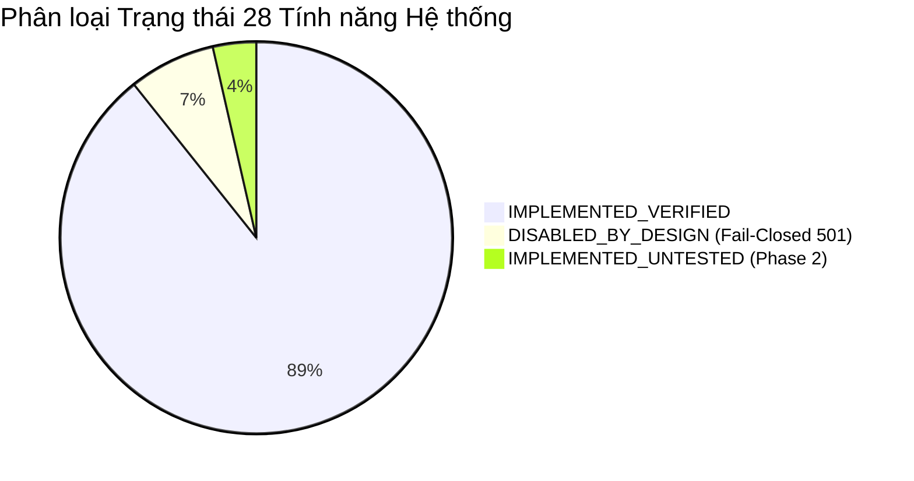

# X-SENTINEL V3 — BÁO CÁO TỔNG QUAN KIỂM TOÁN HỆ THỐNG VÀ BÀN GIAO THIẾT KẾ FRONTEND
## 00-EXECUTIVE-SUMMARY.md — Master Technical Discovery & Frontend Architecture Handoff

> **Tên dự án:** X-SENTINEL V3 — Nền tảng phát hiện Backdoor học máy đa góc nhìn (Cross-View Backdoor Detection) kết hợp Trợ lý Trí tuệ Nhân tạo Cố vấn Cục bộ Jev AI.  
> **Trạng thái Backend:** Hoàn tất toàn bộ 20 kế hoạch triển khai (PLAN-BE-01 đến PLAN-BE-20) theo báo cáo nghiệm thu `docs/handover/FINAL_ACCEPTANCE_REPORT.md` (Git HEAD `99797ff`).  
> **Bộ kiểm thử tự động:** 993/993 tests vượt qua (100% Green, 0 failed, 0 skipped, thời gian chạy ~78-128s).  
> **Mục tiêu tài liệu:** Bàn giao kỹ thuật toàn diện, chính xác và có thể thực thi ngay lập tức cho đội ngũ Frontend Developer hoặc AI Frontend Coding Agent độc lập.

---

## 1. Mục đích và Tầm nhìn Sản phẩm (Product Vision & Architecture)

X-SENTINEL V3 là một giải pháp phòng thủ an ninh mạng chuyên sâu cấp doanh nghiệp (Enterprise Cyber Threat Defense Platform), giải quyết bài toán phát hiện **Trojan/Backdoor chèn vào mô hình học máy phân loại mã độc PE (Portable Executable)**. 

Khác với các công cụ chống mã độc truyền thống chỉ đưa ra điểm xác suất nhị phân, X-SENTINEL áp dụng lý thuyết **Cross-View Semantic Decomposition**:
1. Phân rã không gian 2.381 đặc trưng chuẩn EMBER 2018 thành 3 góc nhìn ngữ nghĩa độc lập:
   - **Structural View (Cấu trúc tệp PE):** Kích thước header, bảng sections, entropy từng section, cờ đặc tính.
   - **Behavioral View (Hành vi động tiềm năng):** Danh sách thư viện nhập khẩu DLL, hàm API nhập khẩu dạng `dll:function`, hàm xuất khẩu.
   - **Metadata View (Thông tin siêu dữ liệu):** Phân phối tần suất byte (Byte Histogram), Byte Entropy Histogram, chuỗi in được (Strings).
2. Chạy đồng thời 5 detector tín hiệu toán học chuyên biệt (**M1 đến M5**):
   - **M1 (TADR):** Đánh giá mức độ thống trị thuộc tính SHAP — Top-1 Attribution Dominance Ratio ($TADR(S) = \max_i(|s_i|) / \sum_i(|s_i|)$).
   - **M2 (Tabular STRIP):** Đo độ hỗn loạn entropy Shannon khi gây nhiễu pha trộn mẫu với tập benign sạch.
   - **M3 (View Concentration):** Đo mức độ tập trung đóng góp SHAP cục bộ vào một góc nhìn đơn lẻ.
   - **M4 (Cross-View Disagreement):** Đo lường sự bất đồng thuận giữa mô hình toàn thể và mô hình suy diễn cục bộ theo từng view.
   - **M5 (Semantic Plausibility):** Kiểm tra các quy tắc bất biến miền nhị phân PE thực tế (Semantic Plausibility Rules on Physical PE Invariants) với xác thực tính toàn vẹn mã băm SHA-256.
3. Tổng hợp qua **Fusion Engine** và hiệu chuẩn ngưỡng **D0/D1 Calibration** để đưa ra phán quyết pháp chứng: **PASS**, **ALERT**, hoặc **QUARANTINE**.
4. Tích hợp Trợ lý AI cố vấn an ninh **Jev AI** (`settings.jev_ai_model`, mặc định `"jev-local-TBD"`, tải động qua `GET /v1/ai/status`) chạy hoàn toàn cục bộ qua LM Studio loopback. Jev AI đóng vai trò phân tích nguyên nhân gốc rễ, hỗ trợ SOC Analyst phân loại cảnh báo (Triage), so sánh mẫu (Compare) và soạn thảo báo cáo (Report).

---

## 2. Bất Biến Cốt Lõi Ảnh Hưởng Đến Thiết Kế Frontend (Core System Invariants)

Bất kỳ lập trình viên hoặc AI Agent nào khi xây dựng giao diện người dùng cho X-SENTINEL V3 đều **BẮT BUỘC TUÂN THỦ TUYỆT ĐỐI 5 BẤT BIẾN SAU**:

### Bất biến 1: Tách Biệt Tuyệt Đối Giữa Bằng Chứng Máy (Canonical Evidence) và Lời Văn Cố Vấn (AI Advisory Narrative)
- **Bằng chứng máy (Ground Truth)** là kết quả tính toán toán học từ LightGBM, TreeSHAP, M1–M5, Fusion và chính sách ngưỡng. Kết quả này mang tính pháp chứng, bất biến, được băm mật mã SHA-256 theo chuẩn RFC 8785 và lưu vĩnh viễn trong CSDL.
- **Jev AI** chỉ là hệ thống tư vấn hỗ trợ (`advisory_only: true`). AI **KHÔNG CÓ QUYỀN** thay đổi điểm số, không được sửa phán quyết (Verdict) từ ALERT thành PASS, không được gỡ QUARANTINE.
- **Quy tắc UI:** Frontend phải sử dụng 2 vùng hiển thị hoàn toàn tách biệt về mặt thị giác. Kết quả máy dùng phong cách phân tích kỹ thuật chuẩn mực (Technical Dashboard), trong khi Jev AI được đặt trong một Drawer/Panel riêng biệt có gắn huy hiệu cố định: `⚠️ AI ADVISORY — NOT AN AUTHORITATIVE VERDICT`.

### Bất biến 2: Kiến Trúc Pure Headless REST API
- Backend hoàn toàn không phục vụ bất kỳ tệp HTML, template Jinja2, hay static CSS/JS nào.
- 100% dữ liệu trao đổi qua JSON chuẩn.
- Các phản hồi lỗi tuân thủ nghiêm ngặt schema: `{"detail": {"code": "XS_...", "message": "..."}}`.

### Bất biến 3: Tính Bất Khả Xâm Phạm Của Lõi Phát Hiện (Zero AI Dependency for Core Detection)
- Lõi phát hiện (M1–M5, LightGBM, Fusion) hoạt động độc lập hoàn toàn với Jev AI. Nếu LM Studio bị sập, quá tải hoặc tắt, API phân tích vector `/v1/analyze/vector` vẫn trả về kết quả trong thời gian thực (<50ms fast-path hoặc ~1.2s end-to-end SHAP) mà không gặp bất kỳ lỗi nào.
- Frontend không bao giờ được phép chặn luồng phân tích chính để chờ phản hồi từ Jev AI.

### Bất biến 4: Pha 1 Tiếp Nhận Vector Số — Pha 2 Khóa Chặt Raw PE (Fail-Closed Gate)
- Trong phiên bản hiện tại (V3 MVP), hệ thống tiếp nhận vector 2.381 chiều EMBER dạng số (`POST /v1/analyze/vector`).
- Endpoint tải lên tệp PE nhị phân thô (`POST /v1/analyze/file`) được cấu hình **khóa an toàn kiểu đóng (Fail-Closed)** trả về `HTTP 501 Not Implemented (XS_FEATURE_DISABLED)` do chưa hoàn tất thủ tục phê duyệt TC-03 của Hội đồng Kiểm soát Thay đổi (CCB).
- **Quy tắc UI:** Giao diện phân tích mặc định là nhập/dán/tải vector JSON 2.381 chiều. Tùy chọn tải file EXE/PE nhị phân phải hiển thị rõ trạng thái `Gated / Phase 2` kèm thông báo giải thích, không để người dùng ngộ nhận là lỗi hệ thống.

### Bất biến 5: Xác Thực và Phân Quyền Kiểm Soát Cứng Phía Server (Authoritative RBAC & IDOR)
- Hệ thống hỗ trợ 4 vai trò: `admin`, `analyst`, `evaluator`, `operator`.
- Frontend chỉ ẩn/hiện menu hoặc nút bấm để tối ưu trải nghiệm (Convenience). Toàn bộ quyền truy cập dữ liệu, quyền xem evidence của người khác (IDOR Prevention) đều được Backend kiểm tra qua `assert_job_ownership()`. Khi bị từ chối, Backend trả về HTTP 403 `XS_FORBIDDEN`.

---

## 3. Tổng Kết Số Liệu Kiểm Toán Kho Mã Nguồn (Repository Audit Summary)

Qua quá trình rà soát trực tiếp 101 modules mã nguồn thực tế và 993 bài test, số liệu định lượng của hệ thống như sau:

| Hạng Mục | Số Lượng Thực Tế | Trạng Thái / Ghi Chú | Bằng Chứng Kiểm Toán |
|---|:---:|---|---|
| **Backend Core Modules** | 11 modules | `api`, `audit`, `data`, `database`, `detection`, `evaluation`, `fusion`, `jev_ai`, `model`, `security`, `services` | `backend/src/x_sentinel/` |
| **API Endpoints** | 21 operations (19 path templates) | 18 operations trong OpenAPI 3.1 (16 active + 2 gated Fail-Closed 501) + 3 operations nội bộ (`include_in_schema=False`) | `x_sentinel/api/routes.py`, `main.py` |
| **Database Entities (Tables)** | 13 tables | Đầy đủ quan hệ Khóa chính, Khóa ngoại, Check Constraints, JSON columns | `x_sentinel/database/models.py` |
| **Database Migrations** | 2 revisions | `0001_v2_multiuser` và `0002_v3_jev_ai_audit` (Single-Head sạch) | `database/migrations/versions/` |
| **Chức năng nghiệp vụ (Features)** | 28 features | 25 IMPLEMENTED_VERIFIED, 2 DISABLED_BY_DESIGN (Fail-Closed 501), 1 IMPLEMENTED_UNTESTED, 0 BLOCKED_PENDING_INPUTS | `docs/frontend-handoff/02-FEATURE-INVENTORY.md` |
| **Các luồng quy trình (Workflows)** | 8 workflows | Từ nạp vector, xem kết quả, Jev AI, xử lý alert đến giám sát telemetry | `docs/baseline/16A_ACTION_CHAINS.md` |
| **Vai trò người dùng (Roles)** | 4 roles | `admin`, `analyst`, `evaluator`, `operator` | `x_sentinel/security/auth.py:L24-L29` |
| **Quyền hạn chi tiết (Permissions)** | 12 permissions | Quản lý phân quyền chi tiết theo ma trận | `x_sentinel/security/policy.py:L16-L31` |
| **Mã lỗi định danh chuẩn (Error Codes)** | 32 mã lỗi | Chuẩn hóa tiền tố `XS_` với cấu trúc JSON envelope nhất quán | `x_sentinel/api/routes.py`, `schemas.py` |
| **Tổng số bài kiểm thử tự động** | 993 tests | 100% PASS (Nghiệm thu BE-20 HEAD `99797ff`; 993 tests đã thu thập & xác minh trong đợt kiểm toán) | `pytest --collect-only` / `pytest -q` |

---

## 4. Phân Loại Trạng Thái Tính Năng Thực Tế (Implementation Status)

Dựa trên nguyên tắc tối thượng **Evidence Over Claims**, 28 chức năng chuẩn hóa (`F-01` đến `F-28`) của X-SENTINEL V3 được phân loại chính xác như sau:



1. **IMPLEMENTED_VERIFIED (Đã triển khai & Xác minh thực nghiệm 100%):**
   - Xác thực schema vector 2.381 chiều số thực hữu hạn (`validate_vector`).
   - Phân cắt 3 Semantic Views (`Structural`: 461, `Behavioral`: 1.342, `Metadata`: 578).
   - Suy diễn mô hình LightGBM (`ember_model_2018.txt`) và bóc tách TreeSHAP cục bộ.
   - 5 Detector signals: M1 (TADR), M2 (Tabular STRIP), M3 (View Concentration), M4 (Cross-View Disagreement), M5 (Semantic Rules).
   - Động cơ tổng hợp tín hiệu Fusion Engine (WeightedSum & Logistic Regression).
   - Phán quyết 3 mức: PASS, ALERT, QUARANTINE kèm theo cờ Demo Mode.
   - Sổ cái bằng chứng pháp chứng Canonical Evidence (19 trường, RFC 8785 JSON canonical hashing).
   - Lưu trữ bền vững hai pha trên Microsoft SQL Server 2022 (Alembic 0002).
   - Toàn bộ REST API: `/v1/analyze/vector`, `/v1/analysis`, `/v1/alerts`, `/v1/ai/runs`.
   - Vòng đời xử lý Alert: Open -> Acknowledged -> Resolved -> Dismissed.
   - Trình điều phối Jev AI với 4 chế độ: Explain, Triage, Compare, Report.
   - Bộ lọc bảo vệ an toàn AI (Guardrails): Chặn rò rỉ Blind Data, chặn Prompt Injection, cô lập loopback nội bộ.
   - Thu thập phản hồi chuyên viên (Analyst Feedback rating 1-5 sao, nhãn đánh giá).
   - Hạn chế lưu lượng đồng thời (Concurrency Limiter 50 detector / 4 AI).
   - Thu thập Telemetry phần cứng thực từ hệ điều hành qua `psutil`.

2. **DISABLED_BY_DESIGN (Khóa an toàn kiểu đóng theo thiết kế):**
   - API phân tích tệp PE nhị phân thô: `POST /v1/analyze/file` (trả về HTTP 501 `XS_FEATURE_DISABLED`).
   - API hỏi đáp tài liệu dự án qua AI: `POST /v1/ai/docs/ask` (trả về HTTP 501 `XS_FEATURE_DISABLED`).
   - Kết nối AI ra bên ngoài Internet (Cloud LLMs): Bị chặn cứng ở tầng guardrail, chỉ cho phép loopback local.

3. **IMPLEMENTED_UNTESTED (Đã triển khai code nhưng chưa kích hoạt test chính thức):**
   - Phân hệ trích xuất đặc trưng thô từ file PE tĩnh (`F-11` — `backend/src/x_sentinel/data/pe_extractor.py`), đang tạm khóa cổng API (`F-12`) chờ phê duyệt CCB.

4. **Nghiên cứu & Hiệu chuẩn khoa học (Research Candidates / Open Questions — 0 tính năng nghiệp vụ bị block):**
   - Bộ mô phỏng tấn công E0–E5 (`artifacts/evaluation/be14_candidate_suite/`).
   - Ngưỡng hiệu chuẩn ứng viên D1 ($\tau = 0.46885$): Đã khóa trong kịch bản nghiên cứu, cần tái hiệu chuẩn trước khi đưa vào môi trường vận hành sản xuất thực tế.
   - `OQ-01`: Đóng băng bảng phân phối đặc trưng khoa học chính thức (`configs/views.scientific.yaml`).
   - `OQ-02`: Đóng băng checksum mô hình khoa học chính thức (`configs/model.scientific.yaml`).
   - Các mô hình LightGBM bị đầu độc (`models/*poison*.txt`) phục vụ đo lường tỷ lệ tấn công thành công ASR trên mô hình nhiễm độc.

---

## 5. Phạm Vi Xây Dựng Frontend (Frontend Scope Summary)

Nhằm đáp ứng 100% các chức năng thực tế của Backend, hệ thống Frontend cần xây dựng bao gồm:

- **10 Trang màn hình chính thức:**
  1. `PAGE-01` — Analyze Workspace (`/analyze`): Nhập/tải vector 2.381 chiều, cấu hình tham số, khu vực file PE có gắn nhãn Phase 2.
  2. `PAGE-02` — Analysis Result & Verdict Dashboard (`/analysis/{id}`): Phán quyết PASS/ALERT/QUARANTINE, điểm số malware/suspicion, cờ demo mode, nút xuất bằng chứng JSON.
  3. `PAGE-03` — Explainability & Cross-View Deep Dive (`/analysis/{id}/explainability`): Đóng góp 3 view, bảng xếp hạng top SHAP features, chi tiết chẩn đoán 5 detector M1–M5.
  4. `PAGE-04` — Jev AI Advisory Studio (`/analysis/{id}/ai-advisory`): Bảng điều khiển Explain, Triage, Compare, Report; biểu đồ logprob; modal gửi feedback.
  5. `PAGE-05` — Analysis History Catalog (`/history`): Bảng dữ liệu phân trang, lọc đa tiêu chí (status, decision, input_mode, demo_mode).
  6. `PAGE-06` — SOC Alerts Incident Console (`/alerts`): Trung tâm xử lý cảnh báo, lọc theo severity và lifecycle status.
  7. `PAGE-07` — Alert Detail & Lifecycle Action Modal (`/alerts/{id}`): Xem chi tiết cảnh báo, chuyển trạng thái (Acknowledge, Resolve, Dismiss) có audit log.
  8. `PAGE-08` — System Status, Health & Telemetry (`/system/status`): Giám sát liveness/readiness, danh sách blockers, telemetry phần cứng thực tế (CPU, RAM, Process).
  9. `PAGE-09` — Evaluation & Scientific Benchmarks (`/evaluation`): Xem kết quả chạy thực nghiệm E0–E5, thông số ASR/FPR/AUROC cho Evaluator/Admin.
  10. `PAGE-10` — Authentication & Role Switcher Console (`/auth/switch`): Đổi Token danh tính mô phỏng (`token-admin`, `token-analyst`, `token-evaluator`, `token-operator`) để kiểm thử phân quyền trực quan.

- **35 Reusable UI Components:** Phân chia thành 7 nhóm (App Shell, Guards, Data Presentation, Form Controls, Feedback, Jev AI Panels, Tables).
- **8 Form nghiệp vụ:** Đầy đủ quy tắc xác thực Client-side (Zod) đồng bộ tuyệt đối với Server-side (Pydantic).
- **3 Data Tables lớn:** Analysis History, Alerts Console, Jev AI Runs Table.

---

## 6. Bản Đồ Bộ Tài Liệu Bàn Giao Kỹ Thuật (Handoff Documentation Map)

Bộ tài liệu được tổ chức tại thư mục `docs/frontend-handoff/` bao gồm 17 tệp Markdown chuyên biệt:

```text
docs/frontend-handoff/
├── 00-EXECUTIVE-SUMMARY.md            <-- (Tệp hiện tại) Tổng quan dự án, trạng thái & phạm vi
├── 01-SYSTEM-ARCHITECTURE.md          <-- Kiến trúc 4 tầng, Pure Headless, Sơ đồ Mermaid & Concurrency
├── 02-FEATURE-INVENTORY.md            <-- Danh mục 28 tính năng chi tiết theo cấu trúc 9 phần
├── 03-API-CATALOG.md                  <-- Đặc tả 21 API operations (19 path templates), schema, mã lỗi, bảng ánh xạ
├── 04-DATABASE-SCHEMA.md              <-- 13 bảng CSDL SQL Server, kiểu dữ liệu, quan hệ & ERD Mermaid
├── 05-AUTH-AND-PERMISSIONS.md         <-- Cơ chế Bearer Tokens, ma trận RBAC, chống IDOR/BOLA
├── 06-BUSINESS-WORKFLOWS.md           <-- 8 luồng nghiệp vụ E2E, Sequence diagrams, State machines
├── 07-FRONTEND-PAGE-INVENTORY.md      <-- Danh sách 10 trang màn hình, mục đích, quyền truy cập & routing
├── 08-PAGE-AND-UI-SPECIFICATIONS.md   <-- Đặc tả chi tiết UI/UX, forms, tables, states & tokens
├── 09-COMPONENT-INVENTORY.md          <-- Danh mục 35 components tái sử dụng, props & interactions
├── 10-FRONTEND-API-INTEGRATION.md     <-- Thiết kế API client, interceptors, error handling & React Query
├── 11-DATA-CONTRACTS.md               <-- Toàn bộ TypeScript Types, Interfaces, Enums & Zod schemas
├── 12-FRONTEND-GAP-ANALYSIS.md        <-- Phân tích 16 khoảng trống kỹ thuật trọng yếu (GAP-01 đến GAP-16) & giải pháp
├── 13-FRONTEND-IMPLEMENTATION-ROADMAP.md <-- Lộ trình triển khai 5 pha, 25 tasks kỹ thuật chi tiết
├── 14-FRONTEND-TEST-STRATEGY.md       <-- Chiến lược kiểm thử UI, MSW integration, a11y & E2E
├── 15-TRACEABILITY-MATRIX.md          <-- Ma trận truy vết từ Yêu cầu -> Code -> API -> UI -> Test
└── 16-FRONTEND-MASTER-BLUEPRINT.md    <-- Bản thiết kế tổng lực cho AI Frontend Coding Agent
```

---

## 7. Kết Luận và Đánh Giá Mức Độ Sẵn Sàng (Readiness Verdict)

### Đánh giá chung: **CONDITIONAL GO (SẴN SÀNG CHO PHÁT TRIỂN FRONTEND V3)**
- **Phân hệ Phân tích Vector & Bằng chứng Pháp chứng:** ĐÃ SẴN SÀNG 100% (Production-Grade).
- **Phân hệ Lịch sử, Cảnh báo & Vận hành:** ĐÃ SẴN SÀNG 100% (Production-Grade).
- **Phân hệ Trợ lý Cố vấn Jev AI:** ĐÃ SẴN SÀNG 100% (Cần khởi chạy LM Studio local để tương tác thực tế, có chế độ fallback hoàn hảo khi offline).
- **Phân hệ Tải tệp PE thô (Raw Binary):** GATED (Frontend chỉ hiển thị giao diện thông báo trạng thái Phase 2).

Tài liệu này cung cấp toàn bộ nền tảng để triển khai Frontend một cách bài bản, chuẩn xác và không có bất kỳ sự mơ hồ kỹ thuật nào.
