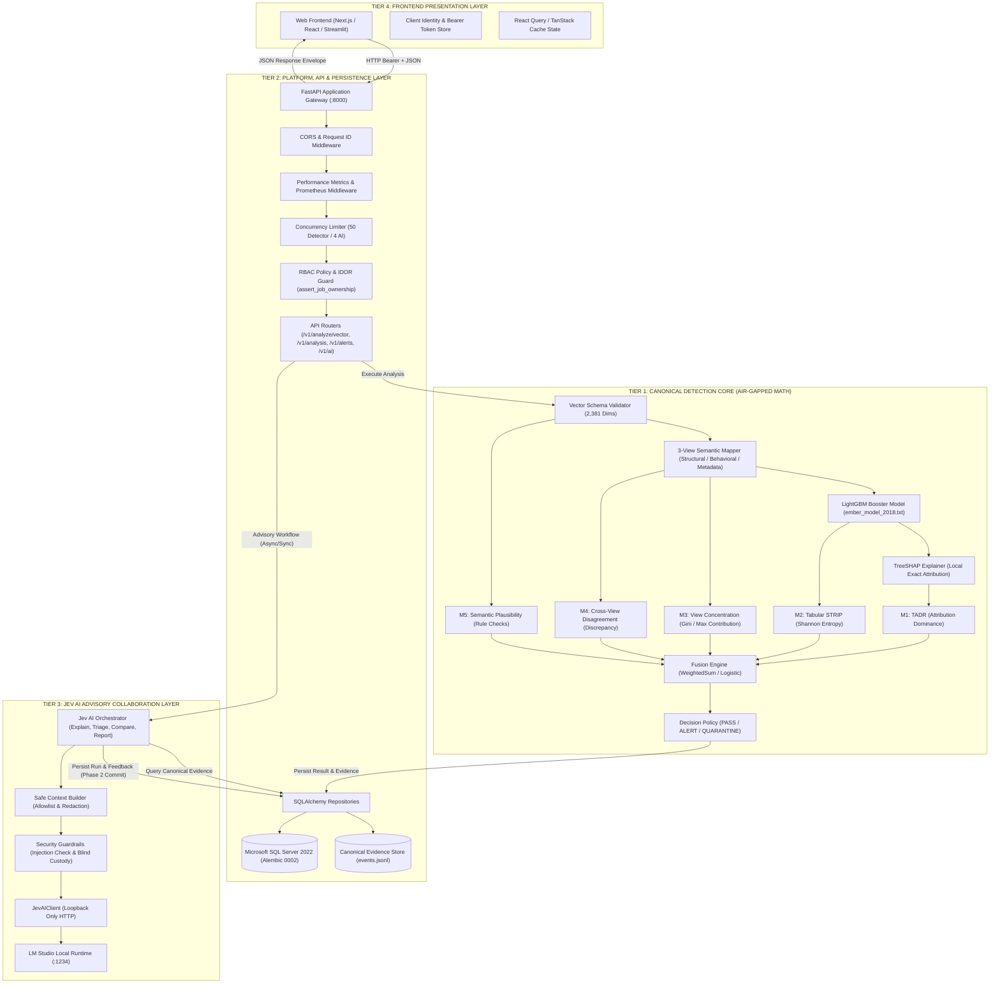
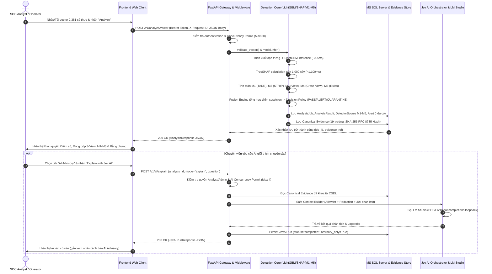

# X-SENTINEL V3 — KIẾN TRÚC HỆ THỐNG VÀ PHÂN TÍCH TỔNG THỂ
## 01-SYSTEM-ARCHITECTURE.md — System Architecture & Logical Topology

> **Mục tiêu:** Mô tả chi tiết kiến trúc tổng thể, ngăn xếp công nghệ thực tế, phân rã các module logic, luồng dữ liệu end-to-end, cơ chế giao dịch và các ràng buộc kỹ thuật mà Frontend bắt buộc phải tuân thủ.

---

## 1. Ngăn Xếp Công Nghệ Thực Tế (Technology Stack Inventory)

Toàn bộ các công nghệ trong hệ thống được xác định chính xác từ mã nguồn (`pyproject.toml`, `docker-compose.yml`, `backend/src/x_sentinel/`):

| Thành phần | Công nghệ / Thư viện | Phiên bản thực tế | Vai trò trong hệ thống | Ràng buộc ảnh hưởng đến Frontend |
|---|---|:---:|---|---|
| **Ngôn ngữ Backend** | Python | `3.12.x` | Toàn bộ backend, detector core, data extraction | Định dạng số thực IEEE-754, xử lý float64 |
| **Framework API** | FastAPI | `0.115.x` | Khung ứng dụng REST API thuần headless | Tự động sinh OpenAPI 3.1, chuẩn hóa schema JSON |
| **ASGI Server** | Uvicorn / Starlette | `0.34.x` / `0.45.x` | Web server bất đồng bộ hiệu năng cao | Timeout kết nối, HTTP header chuẩn hóa |
| **Data Validation** | Pydantic v2 / Settings | `2.10.x` / `2.7.x` | Kiểm thực dữ liệu DTO, cấu hình hệ thống | Lỗi trả về `422 Unprocessable Entity` có chi tiết |
| **ORM / Data Access** | SQLAlchemy 2.0 | `2.0.38+` | Truy vấn cơ sở dữ liệu quan hệ, quan hệ thực thể | Không viết SQL thủ công trong router, dùng Repository |
| **Migration Engine** | Alembic | `1.14.x` | Quản lý vòng đời và phiên bản schema CSDL | Kiểm tra `database_revision == 0002_v3_jev_ai_audit` |
| **Cơ sở dữ liệu chính** | Microsoft SQL Server | `2022` (16.x) | Lưu trữ người dùng, jobs, alerts, evidence, Jev AI | Hỗ trợ kiểu `uniqueidentifier`, JSON `nvarchar(max)` |
| **Database Driver** | pyodbc | `5.2.x` | Kết nối ODBC Driver 17/18 for SQL Server | Cần connection pooling an toàn |
| **ML Inference Engine** | LightGBM | `4.6.x` | Bộ phân loại mã độc tĩnh trên 2.381 đặc trưng EMBER | Mô hình chạy CPU, thời gian suy diễn ~3.5ms |
| **ML Explainability** | TreeSHAP (`shap`) | `0.46.x` | Bóc tách đóng góp đặc trưng SHAP cục bộ | Chạy trên 1.000 cây quyết định, mất ~1.1s - 1.2s |
| **Khoa học dữ liệu** | NumPy, SciPy, Scikit-learn | `2.2.x`, `1.15.x`, `1.6.x` | Tính toán ma trận, entropy, Fisher exact, McNemar | Đảm bảo tính đơn định (deterministic) số học |
| **HTTP Client nội bộ** | HTTPX | `0.28.x` | Gọi API cục bộ tới LM Studio cho Jev AI | Timeout cấu hình 60s, không chặn luồng detector |
| **Local AI Runtime** | LM Studio (OpenAI-compatible) | `settings.jev_ai_model` (`"jev-local-TBD"`) | Cung cấp mô hình quyết định logprob cục bộ | Chỉ liên kết loopback (`localhost`, `127.0.0.1`) |
| **File / Artifact Store** | Local Filesystem / Hash Store | POSIX / NTFS | Lưu trữ tệp bằng chứng `.jsonl` và model weights | Lưu theo đường dẫn URI và băm SHA-256 |
| **Logging & Telemetry** | Python Logging + `psutil` | `5.9.x` | Ghi log có cấu trúc, đo telemetry CPU/RAM thực | Cung cấp endpoint `/v1/system/telemetry` |
| **Metrics Exporter** | Prometheus Client | Chuẩn Text format | Thu thập số liệu hiệu năng, độ trễ p50/p95/p99 | Cung cấp endpoint `/v1/system/metrics` |
| **Kiểm thử tự động** | Pytest, TestClient | `9.0.x` | 993 bài test đơn vị, tích hợp, bảo mật, hiệu năng | Môi trường test dùng SQLite in-memory hermetic |
| **Containerization** | Docker, Docker Compose | Multi-stage build | Đóng gói môi trường thực thi non-root (UID 10001) | Cổng backend 8000, frontend 8501 (Streamlit) |

---

## 2. Kiến Trúc 4 Phân Tầng Độc Lập (4-Tier Architectural Decoupling)

Hệ thống được thiết kế theo nguyên lý phân tách trách nhiệm tuyệt đối thành 4 phân tầng:

### Chi tiết các tầng:

### 2.1. Tier 1 — Canonical Detection Core (Khoa học toán học cô lập)
- **Đặc điểm:** Không có bất kỳ phụ thuộc nào vào mạng, internet, hay Jev AI. Không thực thi mã máy (zero binary execution).
- **Trách nhiệm:** Nhận vector 2.381 chiều, tính toán điểm số malware, bóc tách SHAP, tính 5 tín hiệu M1–M5, tổng hợp qua Fusion Engine và gắn phán quyết (`PASS`, `ALERT`, `QUARANTINE`).
- **Thời gian xử lý:**
  - *Fast-path (chỉ chạy mô hình và M2/M5 thô):* 35ms – 41ms P95.
  - *Full Pipeline (kèm TreeSHAP 1.000 cây và 16 biến thể STRIP):* ~1.195ms P50, ~1.260ms P95.

### 2.2. Tier 2 — Platform, API & Persistence (Cửa ngõ, phân quyền và lưu trữ)
- **Đặc điểm:** Triển khai bằng FastAPI và SQLAlchemy 2, kết nối Microsoft SQL Server 2022.
- **Trách nhiệm:** Kiểm thực đầu vào HTTP, quản lý phiên giao dịch, thực thi chính sách phân quyền RBAC, ngăn chặn truy cập trái phép chéo tài khoản (IDOR/BOLA) qua `assert_job_ownership()`, tạo và lưu trữ bằng chứng pháp chứng bất biến (RFC 8785 JSON Hash).
- **Cơ chế tải nặng:** Giới hạn 50 yêu cầu phân tích đồng thời thông qua `ConcurrencyLimiter`. Vượt quá ngưỡng trả về HTTP 429 `XS_DETECTOR_OVERLOADED`.

### 2.3. Tier 3 — Jev AI Advisory Collaboration (Cố vấn AI an toàn)
- **Đặc điểm:** Bộ điều phối tương tác với mô hình ngôn ngữ cục bộ (Local LLM) qua LM Studio.
- **Trách nhiệm:** Cung cấp 4 chế độ suy luận: Explain (giải thích mẫu), Triage (hướng dẫn SOC phân loại), Compare (so sánh 2 mẫu), Report (soạn thảo báo cáo kỹ thuật).
- **Nguyên tắc an toàn (Guardrails):**
  - Chỉ nhận dữ liệu đã được lọc qua `Safe Context Builder` (loại bỏ token, thông tin nhạy cảm, mã băm nội bộ, blind ground truth).
  - Giới hạn ngữ cảnh 30.000 ký tự.
  - Chỉ cho phép kết nối tới loopback nội bộ (`localhost`, `127.0.0.1`, `host.docker.internal`). Cấm hoàn toàn egress ra internet.
  - Phản hồi sinh ra luôn gắn cờ `advisory_only: true`. Không bao giờ ghi đè lên kết quả máy.
- **Cơ chế tải nặng:** Giới hạn tối đa 4 tác vụ AI đồng thời, hàng đợi tối đa 16 yêu cầu, thời gian chờ tối đa 10s. Vượt quá trả về HTTP 429 `XS_AI_OVERLOADED`.

### 2.4. Tier 4 — Frontend Presentation Layer (Giao diện người dùng)
- **Đặc điểm:** Tầng giao diện độc lập hoàn toàn, giao tiếp với Backend thông qua các hợp đồng REST API JSON chuẩn hóa.
- **Trách nhiệm:** Thu thập vector đầu vào, hiển thị trực quan các phân rã khoa học (SHAP, Cross-View), cung cấp giao diện tương tác với Jev AI và các công cụ quản lý cảnh báo SOC.

---

## 3. Luồng Dữ Liệu End-to-End (Dataflow Walkthrough)

Dưới đây là sơ đồ tương tác tuần tự chi tiết của luồng phân tích hoàn chỉnh:

---

## 4. Cơ Chế Giao Dịch Hai Pha & Tính Nhất Quán (Two-Phase Transaction & Resilience)

Một trong những thiết kế quan trọng nhất của Backend X-SENTINEL V3 là **Decoupled Two-Phase Database Transactions** (Invariant INV-10):

1. **Pha 1 (Bằng chứng máy):** 
   - Dữ liệu kết quả phân tích vector được commit vào SQL Server **ngay lập tức** sau khi lõi phát hiện chạy xong. 
   - Kết nối CSDL được giải phóng hoàn toàn về Connection Pool trước khi bất kỳ yêu cầu mạng nào được gửi tới Jev AI.
   - Điều này triệt tiêu hoàn toàn nguy cơ **Database Connection Exhaustion** và **Deadlock** khi LM Studio suy diễn chậm (1 đến 5 giây).
2. **Pha 2 (Bản ghi AI):** 
   - Khi chuyên viên kích hoạt Jev AI, hệ thống mở một transaction độc lập mới để tạo bản ghi `jev_ai_runs` ở trạng thái `running`.
   - Sau khi nhận được phản hồi từ LM Studio, bản ghi được cập nhật sang `completed` (hoặc `failed`/`blocked` nếu có lỗi) kèm theo mã băm đầu vào `input_digest_sha256` và đầu ra `output_digest_sha256`.
   - Nếu Jev AI thất bại, giao dịch ghi nhận lỗi nhưng **tuyệt đối không rollback** hay làm ảnh hưởng đến bản ghi phân tích gốc `analysis_jobs`.

---

## 5. Ràng Buộc Kỹ Thuật Đối Với Frontend (Architectural Constraints for Frontend)

| Ràng buộc | Lý do kỹ thuật | Cách Frontend bắt buộc phải triển khai |
|---|---|---|
| **Không tính lại điểm số ở Frontend** | Bất biến tính đơn định và pháp chứng | Toàn bộ điểm số, phán quyết, ngưỡng và biểu đồ phải đọc trực tiếp từ API. Tuyệt đối không nhúng công thức tính toán vào code trình duyệt. |
| **Xử lý Timeout & Polling** | TreeSHAP mất ~1.2s; Jev AI mất ~2-5s | Hiển thị Skeleton Loading rõ ràng, cấu hình HTTP timeout tối thiểu 30s cho vector và 60s cho Jev AI. Không spam request liên tục. |
| **Bảo vệ Idempotency (`request_id`)** | Ngăn chặn phân tích lặp lại làm bẩn audit log | Mỗi lần nhấn nút Analyze, Frontend sinh 1 UUIDv4 mới làm `request_id`. Nếu gửi trùng, Backend trả về HTTP 409 `XS_DUPLICATE_REQUEST`. |
| **Quản lý lỗi đồng thời (HTTP 429)** | Concurrency Limiter bảo vệ CPU | Bắt mã `XS_DETECTOR_OVERLOADED` hoặc `XS_AI_OVERLOADED`, hiển thị thông báo "Hệ thống đang bận xử lý, vui lòng thử lại sau vài giây" kèm countdown đếm ngược. |
| **Hiển thị Demo Mode rõ ràng** | Tính minh bạch khoa học | Khi `demo_mode: true`, phán quyết trả về là `DEMO_ONLY`. Frontend phải hiển thị thanh cảnh báo màu vàng ở đầu màn hình: "DEMO MODE — Dữ liệu mang tính tích hợp, không phải bằng chứng khoa học thực tế." |
| **Không để lộ khóa nhận dạng nội bộ** | Nguyên tắc bảo mật người dùng phổ thông | Ẩn các ID kỹ thuật không cần thiết (như UUID khóa ngoại ngầm), chỉ hiển thị `request_id`, mã băm SHA-256 rút gọn (ví dụ `509de4...5e2`) kèm nút copy. |
