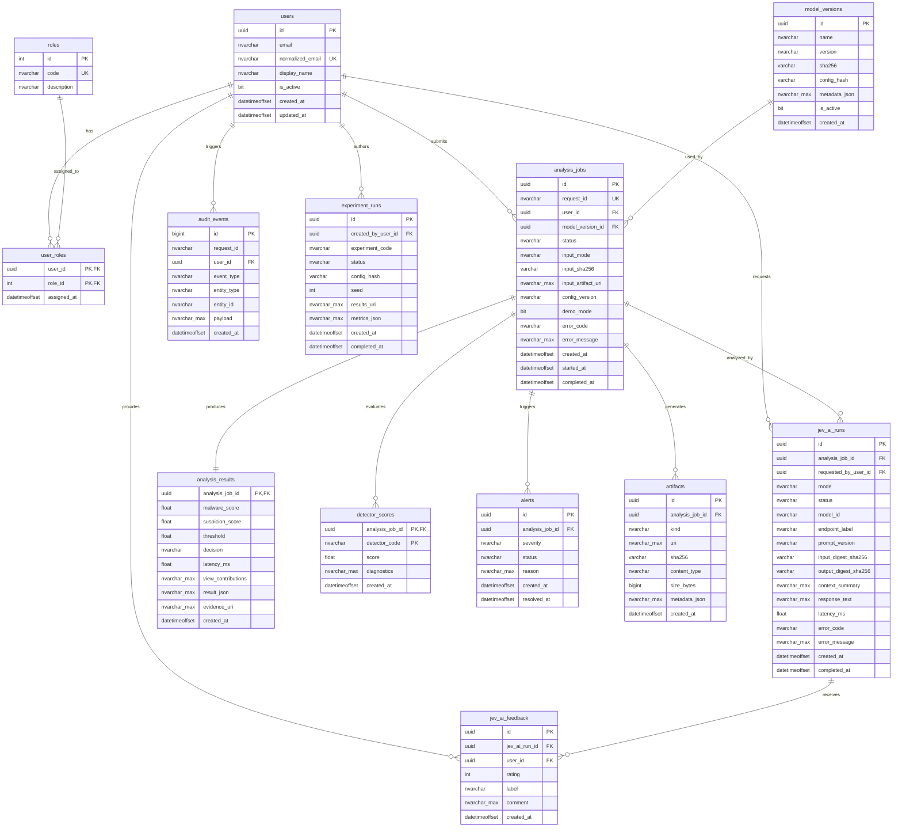

# X-SENTINEL V3 — KIỂM TOÁN CƠ SỞ DỮ LIỆU VÀ MÔ HÌNH THỰC THỂ
## 04-DATABASE-SCHEMA.md — Complete Database Schema & Entity Relationships

> **Hệ quản trị CSDL:** Microsoft SQL Server 2022 / Azure SQL Database.  
> **Phiên bản Schema hiện tại:** `0002_v3_jev_ai_audit` (Alembic Single-Head Migration).  
> **Mục tiêu:** Cung cấp tài liệu cấu trúc CSDL chi tiết, phân tích quan hệ thực thể (ERD) và chỉ rõ những trường dữ liệu nào được API trả về cho Frontend, những trường nào bị che giấu hoặc chỉ đọc.

---

## 1. SƠ ĐỒ QUAN HỆ THỰC THỂ (ENTITY RELATIONSHIP DIAGRAM — MERMAID)

---

## 2. CHI TIẾT 13 BẢNG CƠ SỞ DỮ LIỆU

---

### 1. Bảng `users` — Danh tính Người dùng
- **Mục đích:** Lưu trữ hồ sơ định danh người dùng ổn định, phục vụ phân quyền và xác định quyền sở hữu bản ghi (BOLA/IDOR).
- **Cột:**
  | Tên Cột | Kiểu Dữ Liệu SQL Server | Nullable | Mặc Định | Ràng Buộc / Ghi Chú |
  |---|---|:---:|---|---|
  | `id` | `uniqueidentifier` | No | `NEWID()` | **Khóa chính (PK)** |
  | `email` | `nvarchar(320)` | No | None | Email hiển thị gốc |
  | `normalized_email` | `nvarchar(320)` | No | None | **UNIQUE**, chuẩn hóa chữ thường |
  | `display_name` | `nvarchar(200)` | Yes | None | Tên hiển thị người dùng |
  | `is_active` | `bit` | No | `1` | Trạng thái tài khoản (`1` = hoạt động) |
  | `created_at` | `datetimeoffset` | No | `sysdatetimeoffset()` | Thời gian tạo (UTC) |
  | `updated_at` | `datetimeoffset` | No | `sysdatetimeoffset()` | Thời gian cập nhật cuối (UTC) |

---

### 2. Bảng `roles` — Danh mục Vai trò
- **Mục đích:** Danh mục các vai trò chuẩn trong hệ thống (`admin`, `analyst`, `evaluator`, `operator`).
- **Cột:**
  | Tên Cột | Kiểu Dữ Liệu | Nullable | Mặc Định | Ràng Buộc |
  |---|---|:---:|---|---|
  | `id` | `int` | No | `IDENTITY(1,1)` | **Khóa chính (PK)** |
  | `code` | `nvarchar(64)` | No | None | **UNIQUE**, mã vai trò |
  | `description` | `nvarchar(255)` | Yes | None | Mô tả nhiệm vụ vai trò |

---

### 3. Bảng `user_roles` — Gán Vai trò cho Người dùng
- **Mục đích:** Bảng nối quan hệ Nhiều-Nhiều (Many-to-Many) giữa người dùng và vai trò.
- **Cột:**
  | Tên Cột | Kiểu Dữ Liệu | Nullable | Khóa / Ràng Buộc |
  |---|---|:---:|---|
  | `user_id` | `uniqueidentifier` | No | **PK, FK** -> `users(id)` ON DELETE CASCADE |
  | `role_id` | `int` | No | **PK, FK** -> `roles(id)` ON DELETE CASCADE |
  | `assigned_at` | `datetimeoffset` | No | Mặc định `sysdatetimeoffset()` |

---

### 4. Bảng `model_versions` — Phiên bản Mô hình Học máy
- **Mục đích:** Gắn kết từng phân tích với một phiên bản artifact mô hình LightGBM xác định.
- **Cột:**
  | Tên Cột | Kiểu Dữ Liệu | Nullable | Ràng Buộc |
  |---|---|:---:|---|
  | `id` | `uniqueidentifier` | No | **PK** |
  | `name` | `nvarchar(120)` | No | Tên mô hình (vd: `ember_model_2018`) |
  | `version` | `nvarchar(120)` | No | Chuỗi phiên bản (vd: `2018.v3`) |
  | `sha256` | `varchar(64)` | No | Mã băm artifact mô hình (`509de4...`) |
  | `config_hash` | `varchar(64)` | No | Mã băm cấu hình đi kèm |
  | `metadata_json` | `nvarchar(max)` | No | Dữ liệu siêu hình học JSON (mặc định `N'{}'`) |
  | `is_active` | `bit` | No | Mặc định `0` (chỉ 1 mô hình active chính thức) |
  | `created_at` | `datetimeoffset` | No | Thời điểm đăng ký |
- **Ràng buộc:** `UNIQUE(name, version)`.

---

### 5. Bảng `analysis_jobs` — Quản lý Vòng đời Tác vụ Phân tích
- **Mục đích:** Thực thể cốt lõi ghi nhận từng yêu cầu phân tích nạp vào hệ thống.
- **Cột:**
  | Tên Cột | Kiểu Dữ Liệu | Nullable | Ràng Buộc / Ghi Chú |
  |---|---|:---:|---|
  | `id` | `uniqueidentifier` | No | **PK** |
  | `request_id` | `nvarchar(128)` | No | **UNIQUE, INDEX**, mã yêu cầu chống trùng lặp |
  | `user_id` | `uniqueidentifier` | Yes | **FK, INDEX** -> `users(id)` ON DELETE SET NULL |
  | `model_version_id` | `uniqueidentifier` | Yes | **FK, INDEX** -> `model_versions(id)` ON DELETE SET NULL |
  | `status` | `nvarchar(32)` | No | **INDEX**, Mặc định `queued` |
  | `input_mode` | `nvarchar(32)` | No | Mặc định `vector` |
  | `input_sha256` | `varchar(64)` | Yes | **INDEX**, mã băm SHA-256 của vector/file |
  | `input_artifact_uri`| `nvarchar(max)` | Yes | Đường dẫn tệp lưu trữ artifact ngoài DB |
  | `config_version` | `nvarchar(128)` | Yes | Phiên bản cấu hình áp dụng |
  | `demo_mode` | `bit` | No | Mặc định `1` (`1` = Demo Mode) |
  | `error_code` | `nvarchar(128)` | Yes | Mã lỗi nếu job thất bại |
  | `error_message` | `nvarchar(max)` | Yes | Thông điệp lỗi chi tiết |
  | `created_at` | `datetimeoffset` | No | **INDEX**, thời điểm tạo job |
  | `started_at` | `datetimeoffset` | Yes | Thời điểm bắt đầu chạy suy diễn |
  | `completed_at` | `datetimeoffset` | Yes | Thời điểm kết thúc suy diễn |
- **Check Constraints:**
  - `status IN ('queued', 'running', 'completed', 'failed', 'quarantined')`
  - `input_mode IN ('vector', 'raw_pe')`

---

### 6. Bảng `analysis_results` — Kết quả Phân tích Cuối cùng
- **Mục đích:** Lưu trữ phán quyết chính thức, điểm số tổng hợp và đóng góp 3 góc nhìn (Quan hệ 1-1 với `analysis_jobs`).
- **Cột:**
  | Tên Cột | Kiểu Dữ Liệu | Nullable | Ràng Buộc |
  |---|---|:---:|---|
  | `analysis_job_id` | `uniqueidentifier` | No | **PK, FK** -> `analysis_jobs(id)` ON DELETE CASCADE |
  | `malware_score` | `float` | Yes | Điểm xác suất mã độc từ LightGBM $[0.0, 1.0]$ |
  | `suspicion_score` | `float` | Yes | Điểm nghi ngờ backdoor từ Fusion Engine $[0.0, 1.0]$ |
  | `threshold` | `float` | Yes | Ngưỡng quyết định đã áp dụng |
  | `decision` | `nvarchar(32)` | No | Phán quyết: `unknown`, `pass`, `alert`, `quarantine` |
  | `latency_ms` | `float` | Yes | Tổng thời gian thực thi (mili-giây) |
  | `view_contributions` | `nvarchar(max)` | No | JSON: `{"structural": ..., "behavioral": ..., "metadata": ...}` |
  | `result_json` | `nvarchar(max)` | No | Bản ghi kết quả đầy đủ định dạng JSON |
  | `evidence_uri` | `nvarchar(max)` | Yes | URI trỏ tới tệp bằng chứng trên đĩa |
  | `created_at` | `datetimeoffset` | No | Thời điểm ghi kết quả |
- **Check Constraints:** `decision IN ('unknown', 'pass', 'alert', 'quarantine')`.

---

### 7. Bảng `detector_scores` — Điểm số Chi tiết 5 Detector (M1–M5)
- **Mục đích:** Chuẩn hóa lưu trữ kết quả phân rã tín hiệu của từng detector thành các hàng riêng biệt (Quan hệ 1-Nhiều từ `analysis_jobs`).
- **Cột:**
  | Tên Cột | Kiểu Dữ Liệu | Nullable | Ràng Buộc |
  |---|---|:---:|---|
  | `analysis_job_id` | `uniqueidentifier` | No | **PK, FK** -> `analysis_jobs(id)` ON DELETE CASCADE |
  | `detector_code` | `nvarchar(16)` | No | **PK**, Mã detector: `M1`, `M2`, `M3`, `M4`, `M5` |
  | `score` | `float` | No | Điểm số chuẩn hóa trong $[0.0, 1.0]$ |
  | `diagnostics` | `nvarchar(max)` | No | JSON chứa thông số chẩn đoán trung gian |
  | `created_at` | `datetimeoffset` | No | sysdatetimeoffset() |
- **Khóa chính hợp thành (Composite PK):** `(analysis_job_id, detector_code)`.
- **Check Constraints:** `detector_code IN ('M1', 'M2', 'M3', 'M4', 'M5')`.

---

### 8. Bảng `alerts` — Cảnh báo An ninh SOC
- **Mục đích:** Quản lý vòng đời cảnh báo và sự cố do hệ thống phát hiện.
- **Cột:**
  | Tên Cột | Kiểu Dữ Liệu | Nullable | Ràng Buộc / Ghi Chú |
  |---|---|:---:|---|
  | `id` | `uniqueidentifier` | No | **PK** |
  | `analysis_job_id` | `uniqueidentifier` | No | **FK, INDEX** -> `analysis_jobs(id)` ON DELETE CASCADE |
  | `severity` | `nvarchar(16)` | No | Mặc định `medium` |
  | `status` | `nvarchar(32)` | No | **INDEX**, Mặc định `open` |
  | `reason` | `nvarchar(max)` | No | Lý do phát sinh cảnh báo |
  | `created_at` | `datetimeoffset` | No | Thời điểm kích hoạt cảnh báo |
  | `resolved_at` | `datetimeoffset` | Yes | Thời điểm chuyên viên giải quyết xong |
- **Check Constraints:**
  - `severity IN ('low', 'medium', 'high', 'critical')`
  - `status IN ('open', 'acknowledged', 'resolved', 'dismissed')`

---

### 9. Bảng `artifacts` — Quản lý Con trỏ Tệp và Bằng chứng
- **Mục đích:** Lưu trữ metadata và mã băm SHA-256 trỏ tới các tệp nhị phân, mô hình hoặc bằng chứng lớn nằm ngoài CSDL.
- **Cột:**
  | Tên Cột | Kiểu Dữ Liệu | Nullable | Ràng Buộc |
  |---|---|:---:|---|
  | `id` | `uniqueidentifier` | No | **PK** |
  | `analysis_job_id` | `uniqueidentifier` | Yes | **FK, INDEX** -> `analysis_jobs(id)` ON DELETE CASCADE |
  | `kind` | `nvarchar(64)` | No | **INDEX**, Loại artifact (vd: `evidence`, `model`, `export`) |
  | `uri` | `nvarchar(max)` | No | Đường dẫn URI tệp lưu trữ |
  | `sha256` | `varchar(64)` | No | **INDEX**, Mã băm mật mã SHA-256 |
  | `content_type` | `nvarchar(255)` | Yes | MIME type (vd: `application/json`) |
  | `size_bytes` | `bigint` | Yes | Dung lượng tệp tính bằng byte |
  | `metadata_json` | `nvarchar(max)` | No | JSON siêu dữ liệu bổ trợ |
  | `created_at` | `datetimeoffset` | No | Thời điểm tạo |

---

### 10. Bảng `audit_events` — Sổ cái Kiểm toán Bất biến (Append-Only)
- **Mục đích:** Ghi nhận mọi biến động trạng thái nhạy cảm trong hệ thống để phục vụ điều tra pháp chứng. Cấm cập nhật hoặc xóa.
- **Cột:**
  | Tên Cột | Kiểu Dữ Liệu | Nullable | Ràng Buộc |
  |---|---|:---:|---|
  | `id` | `bigint` | No | **PK, IDENTITY(1,1)** |
  | `request_id` | `nvarchar(128)` | Yes | **INDEX**, mã tương quan yêu cầu |
  | `user_id` | `uniqueidentifier` | Yes | **FK, INDEX** -> `users(id)` ON DELETE SET NULL |
  | `event_type` | `nvarchar(128)` | No | **INDEX**, tên sự kiện (vd: `alert.status_updated`) |
  | `entity_type` | `nvarchar(64)` | Yes | Tên bảng bị tác động (vd: `alert`) |
  | `entity_id` | `nvarchar(128)` | Yes | ID thực thể bị tác động |
  | `payload` | `nvarchar(max)` | No | JSON chi tiết sự thay đổi (trạng thái cũ, trạng thái mới) |
  | `created_at` | `datetimeoffset` | No | **INDEX**, thời gian ghi nhận (UTC) |

---

### 11. Bảng `experiment_runs` — Quản lý Thực nghiệm Nghiên cứu E0–E5
- **Mục đích:** Lưu trữ thông số chạy thực nghiệm và chỉ số nghiên cứu. **Không chứa nhãn bí mật hoặc blind ground truth.**
- **Cột:**
  | Tên Cột | Kiểu Dữ Liệu | Nullable | Ràng Buộc |
  |---|---|:---:|---|
  | `id` | `uniqueidentifier` | No | **PK** |
  | `created_by_user_id`| `uniqueidentifier` | Yes | **FK, INDEX** -> `users(id)` ON DELETE SET NULL |
  | `experiment_code` | `nvarchar(16)` | No | **INDEX**, mã thí nghiệm (`E0` đến `E5`) |
  | `status` | `nvarchar(32)` | No | Mặc định `planned` |
  | `config_hash` | `varchar(64)` | No | Mã băm cấu hình thực nghiệm |
  | `seed` | `int` | Yes | Random seed tái tạo |
  | `results_uri` | `nvarchar(max)` | Yes | URI trỏ tới thư mục kết quả trên đĩa |
  | `metrics_json` | `nvarchar(max)` | No | JSON chứa các chỉ số ASR, FPR, AUROC |
  | `created_at` | `datetimeoffset` | No | Thời điểm khởi tạo |
  | `completed_at` | `datetimeoffset` | Yes | Thời điểm hoàn thành |
- **Check Constraints:**
  - `experiment_code IN ('E0', 'E1', 'E2', 'E3', 'E4', 'E5')`
  - `status IN ('planned', 'running', 'completed', 'failed')`

---

### 12. Bảng `jev_ai_runs` — Nhật ký Thực thi Cố vấn Jev AI
- **Mục đích:** Ghi nhận độc lập từng lần gọi mô hình ngôn ngữ cục bộ LM Studio mà không làm bẩn kết quả máy.
- **Cột:**
  | Tên Cột | Kiểu Dữ Liệu | Nullable | Ràng Buộc / Ghi Chú |
  |---|---|:---:|---|
  | `id` | `uniqueidentifier` | No | **PK** |
  | `analysis_job_id` | `uniqueidentifier` | Yes | **FK, INDEX** -> `analysis_jobs(id)` ON DELETE SET NULL |
  | `requested_by_user_id`| `uniqueidentifier`| Yes | **FK, INDEX** -> `users(id)` ON DELETE SET NULL |
  | `mode` | `nvarchar(32)` | No | **INDEX**, Chế độ suy luận |
  | `status` | `nvarchar(32)` | No | **INDEX**, Mặc định `queued` |
  | `model_id` | `nvarchar(255)` | No | Tên mô hình trong LM Studio |
  | `endpoint_label` | `nvarchar(120)` | No | Mặc định `lm_studio_local` |
  | `prompt_version` | `nvarchar(120)` | No | Phiên bản hợp đồng prompt (vd: `jev-v3.0.0`) |
  | `input_digest_sha256`| `varchar(64)` | No | **INDEX**, Mã băm ngữ cảnh đầu vào an toàn |
  | `output_digest_sha256`| `varchar(64)` | Yes | **INDEX**, Mã băm văn bản sinh ra |
  | `context_summary` | `nvarchar(max)` | No | JSON tóm tắt các trường đã gửi cho AI |
  | `response_text` | `nvarchar(max)` | Yes | Văn bản Markdown do AI sinh ra |
  | `latency_ms` | `float` | Yes | Thời gian suy diễn của LM Studio |
  | `error_code` | `nvarchar(128)` | Yes | Mã lỗi nếu thất bại |
  | `error_message` | `nvarchar(max)` | Yes | Thông điệp lỗi chi tiết |
  | `created_at` | `datetimeoffset` | No | **INDEX**, thời điểm gửi yêu cầu |
  | `completed_at` | `datetimeoffset` | Yes | Thời điểm nhận phản hồi |
- **Check Constraints:**
  - `mode IN ('explain', 'triage', 'compare', 'report', 'docs')`
  - `status IN ('queued', 'running', 'completed', 'failed', 'blocked')`

---

### 13. Bảng `jev_ai_feedback` — Đánh giá Phản hồi của Chuyên viên
- **Mục đích:** Thu thập đánh giá độ chính xác và tính hữu ích của Jev AI từ chuyên viên an ninh.
- **Cột:**
  | Tên Cột | Kiểu Dữ Liệu | Nullable | Ràng Buộc |
  |---|---|:---:|---|
  | `id` | `uniqueidentifier` | No | **PK** |
  | `jev_ai_run_id` | `uniqueidentifier` | No | **FK, INDEX** -> `jev_ai_runs(id)` ON DELETE CASCADE |
  | `user_id` | `uniqueidentifier` | Yes | **FK, INDEX** -> `users(id)` ON DELETE SET NULL |
  | `rating` | `int` | Yes | Đánh giá sao từ 1 đến 5 |
  | `label` | `nvarchar(32)` | Yes | Nhãn phân loại chất lượng |
  | `comment` | `nvarchar(max)` | Yes | Ý kiến đóng góp của chuyên viên |
  | `created_at` | `datetimeoffset` | No | sysdatetimeoffset() |
- **Check Constraints:**
  - `rating IS NULL OR (rating >= 1 AND rating <= 5)`
  - `label IS NULL OR label IN ('helpful', 'not_helpful', 'incorrect', 'unsafe', 'unclear')`

---

## 3. LIÊN HỆ GIỮA CSDL VÀ GIAO DIỆN FRONTEND (FRONTEND DATA EXPOSURE AUDIT)

Để đảm bảo tính bảo mật và tính toàn vẹn của mô hình phát hiện, **Frontend chỉ được phép truy cập dữ liệu thông qua các hợp đồng API công khai**, không bao giờ được truy vấn trực tiếp CSDL:

| Tên Bảng | Trường được API Expose cho Frontend | Trường CHỈ ĐỌC (Read-Only) | Trường BỊ ẨN / CHE GIẤU KHỎI FRONTEND |
|---|---|---|---|
| `users` | `display_name`, `email` | Toàn bộ | `normalized_email`, token credentials nội bộ |
| `analysis_jobs` | `id`, `request_id`, `status`, `input_mode`, `demo_mode`, `created_at`, `completed_at` | Toàn bộ | `input_artifact_uri` (đường dẫn ổ đĩa vật lý của server) |
| `analysis_results` | `malware_score`, `suspicion_score`, `threshold`, `decision`, `latency_ms`, `view_contributions` | Toàn bộ | `evidence_uri` (chỉ trả về mã băm `evidence_ref`) |
| `detector_scores` | `detector_code`, `score`, `diagnostics` | Toàn bộ | Khóa ngoại kỹ thuật |
| `alerts` | `id`, `severity`, `status`, `reason`, `created_at`, `resolved_at` | `id`, `created_at`, `reason` | Trường nội bộ không liên quan (chỉ cập nhật qua trường `status`) |
| `artifacts` | `kind`, `sha256`, `content_type`, `size_bytes` | Toàn bộ | `uri` (đường dẫn thư mục nội bộ server) |
| `audit_events` | `event_type`, `payload`, `created_at` (qua log chi tiết) | Toàn bộ | ID cơ sở dữ liệu nội bộ |
| `jev_ai_runs` | `id`, `mode`, `status`, `model_id`, `prompt_version`, `response_text`, `decision_result`, `latency_ms` | Toàn bộ | Biểu thức system prompt nội bộ và raw prompt text |
| `jev_ai_feedback`| `id`, `rating`, `label`, `comment`, `created_at` | `id`, `created_at` | None (được tạo mới qua POST API) |

---

## 4. CHIẾN LƯỢC ĐÁNH CHỈ MỤC VÀ TỐI ƯU TRUY VẤN (INDEXING STRATEGY)

Hệ thống đã thiết lập sẵn 16 chỉ mục chuyên biệt trong SQL Server đảm bảo hiệu năng tải trang Frontend luôn $< 50\text{ms}$:
1. **Truy vấn lịch sử cá nhân hóa:** `CREATE INDEX ix_analysis_jobs_user_created ON analysis_jobs (user_id, created_at DESC)` -> Giúp tải trang `/history` tức thì.
2. **Tìm kiếm Job theo mã tương quan:** `CREATE UNIQUE INDEX ix_analysis_jobs_request_id ON analysis_jobs (request_id)` -> Đảm bảo kiểm tra trùng lặp trong $O(1)$.
3. **Lọc cảnh báo SOC đang mở:** `CREATE INDEX ix_alerts_status_severity ON alerts (status, severity)` -> Giúp SOC Console cập nhật danh sách cảnh báo tức thì.
4. **Truy vết lượt chạy AI theo Job:** `CREATE INDEX ix_jev_ai_runs_analysis_created ON jev_ai_runs (analysis_job_id, created_at DESC)` -> Giúp hiển thị nhanh lịch sử cố vấn AI của mẫu phân tích.
