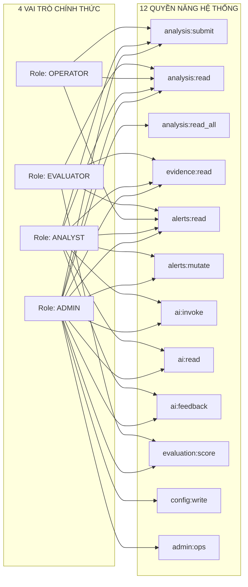

# X-SENTINEL V3 — XÁC THỰC, PHÂN QUYỀN VÀ BẢO MẬT HỆ THỐNG
## 05-AUTH-AND-PERMISSIONS.md — Authentication, Role-Based Access Control & Security Contracts

> **Mục tiêu:** Cung cấp tài liệu toàn diện về cơ chế xác thực Bearer Token, ma trận phân quyền chi tiết (RBAC), quy tắc phòng chống lỗ hổng BOLA/IDOR và hướng dẫn triển khai tầng bảo mật an toàn phía Frontend.

---

## 1. CƠ CHẾ XÁC THỰC THỰC TẾ (AUTHENTICATION ARCHITECTURE)

Hệ thống X-SENTINEL V3 hỗ trợ 2 chế độ xác thực thông qua biến môi trường `XS_API_AUTH_MODE`:

1. **Chế độ Phát triển / Thử nghiệm (`XS_API_AUTH_MODE=none`):**
   - Mọi yêu cầu HTTP không mang header `Authorization` sẽ được hệ thống tự động gán danh tính ẩn danh đặc biệt `ANONYMOUS_USER`:
     - `User ID`: `00000000-0000-0000-0000-000000000001`
     - `Email`: `anonymous@xsentinel.local`
     - `Roles`: Toàn quyền (`admin`, `analyst`, `operator`, `evaluator`).
   - Phù hợp cho việc phát triển giao diện nhanh và chạy kiểm thử tự động nội bộ.

2. **Chế độ Sản xuất / Bảo mật có kiểm soát (`XS_API_AUTH_MODE=bearer`):**
   - Yêu cầu bắt buộc phải đính kèm Header HTTP:
     ```http
     Authorization: Bearer <access_token>
     ```
   - Nếu thiếu header -> Backend trả về `HTTP 401 Unauthorized` (`XS_UNAUTHENTICATED`).
   - Nếu token không hợp lệ -> Backend trả về `HTTP 401 Unauthorized` (`XS_INVALID_CREDENTIALS`).
   - Nếu tài khoản gắn với token bị khóa (`is_active = False`) -> Backend trả về `HTTP 403 Forbidden` (`XS_FORBIDDEN`: "Authenticated user account is inactive").

### Danh sách Predefined Bearer Tokens trong Hệ Thống:
Để hỗ trợ việc tích hợp và kiểm thử giao diện phân quyền mà không cần dựng cụm OAuth2 phức tạp, Backend đã tích hợp sẵn 5 bộ token danh tính chuẩn:

| Bearer Token Chuẩn | Email Định Danh | Vai Trò Gán Kèm (Roles) | UUID Người Dùng Trong CSDL | Trạng Thái Tài Khoản |
|---|---|---|---|:---:|
| `token-admin` | `admin@xsentinel.local` | `admin`, `analyst`, `operator` | `11111111-1111-1111-1111-111111111111` | Hoạt động (`Active`) |
| `token-analyst` | `analyst@xsentinel.local` | `analyst`, `operator` | `22222222-2222-2222-2222-222222222222` | Hoạt động (`Active`) |
| `token-evaluator`| `evaluator@xsentinel.local`| `evaluator` | `33333333-3333-3333-3333-333333333333` | Hoạt động (`Active`) |
| `token-operator` | `operator@xsentinel.local` | `operator` | `44444444-4444-4444-4444-444444444444` | Hoạt động (`Active`) |
| `token-analyst-2`| `analyst2@xsentinel.local`| `analyst`, `operator` | `55555555-5555-5555-5555-555555555555` | Hoạt động (Dùng test IDOR) |
| `token-inactive` | `inactive@xsentinel.local` | `admin`, `analyst` | `66666666-6666-6666-6666-666666666666` | Bị khóa (`is_active: false`) |

---

## 2. MA TRẬN PHÂN QUYỀN TOÀN DIỆN (RBAC & CAPABILITIES MATRIX)

Hệ thống quản lý 12 quyền năng (`Permission`) phân bổ cho 4 vai trò chính thức theo tài liệu hiến pháp `docs/baseline/19_PERMISSION_MATRIX.md` và mã nguồn `x_sentinel/security/policy.py`:



### Bảng Ma Trận Phân Quyền Chi Tiết:

| Tài Nguyên | Hành Động | Quyền Yêu Cầu | Admin | Analyst | Operator | Evaluator | Endpoint API Tương Ứng | Tác Động Giao Diện Frontend |
|---|---|---|:---:|:---:|:---:|:---:|---|---|
| **Vector Ingestion** | Gửi vector phân tích | `analysis:submit` | ✅ | ✅ | ✅ | ❌ | `POST /v1/analyze/vector` | Hiện form nạp & nút "Analyze" |
| **Analysis History** | Xem lịch sử của mình | `analysis:read` | ✅ | ✅ | ✅ | ✅ | `GET /v1/analysis` | Hiển thị menu "History" & bảng job |
| **Analysis History** | Xem toàn bộ lịch sử hệ thống | `analysis:read_all` | ✅ | ❌ | ❌ | ❌ | `GET /v1/analysis` (bỏ filter user) | Hiển thị toggle "Xem toàn hệ thống" |
| **Forensic Detail** | Xem chi tiết bản ghi phân tích | `analysis:read` | ✅ | ✅* | ✅* | ✅ | `GET /v1/analysis/{id}` | Mở trang `/analysis/{id}` (*chỉ xem của mình) |
| **Canonical Evidence**| Tải gói bằng chứng 19 trường | `evidence:read` | ✅ | ✅* | ❌ | ✅ | `GET /v1/analysis/{id}/evidence` | Nút "Download Evidence JSON" (*của mình) |
| **SOC Alerts** | Xem danh sách cảnh báo | `alerts:read` | ✅ | ✅ | ✅ | ❌ | `GET /v1/alerts` | Hiển thị menu "Alerts Console" |
| **SOC Alerts** | Thay đổi trạng thái cảnh báo | `alerts:mutate` | ✅ | ✅ | ❌ | ❌ | `PATCH /v1/alerts/{id}` | Hiện nút Acknowledge/Resolve (Operator bị ẩn) |
| **Jev AI Advisory** | Gọi AI suy luận (Explain...) | `ai:invoke` | ✅ | ✅ | ❌ | ❌ | `POST /v1/ai/explain` | Nút "Explain with Jev AI" (Operator bị disabled) |
| **Jev AI Advisory** | Xem kết quả văn bản AI | `ai:read` | ✅ | ✅ | ❌ | ❌ | `GET /v1/ai/runs` | Tab "AI Advisory" trong trang chi tiết |
| **Jev AI Advisory** | Gửi đánh giá sao & nhận xét | `ai:feedback` | ✅ | ✅ | ❌ | ❌ | `POST /v1/ai/runs/{id}/feedback` | Khung 5 sao đánh giá dưới phản hồi AI |
| **Scientific Benchmark**| Chấm điểm thực nghiệm E0-E5 | `evaluation:score` | ✅ | ❌ | ❌ | ✅ | Nội bộ runner / Admin route | Hiển thị menu "Evaluation Benchmarks" |
| **System Admin** | Xem Telemetry & Metrics | Role: `admin`, `operator` (`admin:ops`*) | ✅ | ❌ | ✅ | ❌ | `GET /v1/system/telemetry` | Tab "Hardware Telemetry" trên PAGE-08 (*Route kiểm tra role trực tiếp qua `require_roles("admin", "operator")`; trong `policy.py` chỉ `admin` có quyền `admin:ops`, `operator` không có `admin:ops`) |

---

## 3. PHÒNG THỦ LỖ HỔNG TRUY CẬP ĐỐI TƯỢNG (BOLA / IDOR PREVENTION)

Backend X-SENTINEL V3 thực thi nghiêm ngặt cơ chế bảo vệ quyền sở hữu dữ liệu ở tầng Service qua hàm `assert_job_ownership()`:

```python
def assert_job_ownership(job: AnalysisJob, user: AuthUser | None, allow_evaluator: bool = False):
    if is_admin(user):
        return  # Admin có quyền xem mọi bản ghi
    if allow_evaluator and user.has_role(Role.EVALUATOR.value):
        return  # Evaluator được phép xem phục vụ kiểm thử
    if job.user_id is not None and user is not None and job.user_id != user.user_id:
        raise ObjectAccessDeniedError(code="XS_FORBIDDEN", message="Access denied: resource belongs to another user")
```

### Ràng buộc thực thi phía Frontend:
1. **Lọc tự động danh sách:** Khi gọi `GET /v1/analysis`, Backend tự động lọc theo `user_id` của token hiện tại đối với vai trò `analyst` và `operator`. Frontend không cần tự lọc thủ công ở client.
2. **Xử lý mã lỗi 403 Forbidden:** Nếu người dùng copy link URL trực tiếp của một bản ghi do chuyên viên khác tạo (ví dụ: Chuyên viên 2 mở link của Chuyên viên 1), Backend sẽ từ chối với HTTP 403 `XS_FORBIDDEN`.
   - **Giao diện:** Frontend bắt mã lỗi này và hiển thị màn hình State `ForbiddenState` thân thiện kèm nút: *"Quay lại danh sách phân tích của bạn"*.

---

## 4. CHIẾN LƯỢC QUẢN LÝ DANH TÍNH PHÍA FRONTEND (CLIENT-SIDE AUTH LIFECYCLE)

Để đảm bảo an toàn tuyệt đối và hỗ trợ kiểm thử tiện lợi, Frontend cần xây dựng kiến trúc quản lý token như sau:

### 4.1. Lưu trữ Token An Toàn
- Lưu trữ access token trong `sessionStorage` (hoặc `localStorage` nếu muốn duy trì qua các phiên làm việc).
- Không bao giờ in token ra `console.log` trong môi trường Production.
- Cung cấp component `RoleSwitcher` ở góc dưới giao diện phát triển để chuyên viên kiểm thử có thể chuyển đổi nhanh giữa các token:
  - Nút nhanh: `[Admin]` `[Analyst]` `[Operator]` `[Evaluator]` `[Tamper/Inactive]`.
- **Cấm Tuyệt Đối Hardcoded Fallback Token:** Không được gắn token dự phòng mặc định (như `token || 'token-analyst'`) trong request interceptor. Mọi yêu cầu chưa xác thực phải được gửi đi không kèm header Authorization để Backend chủ động kích hoạt cơ chế phòng vệ Fail-Closed HTTP 401 `XS_UNAUTHENTICATED` (thiếu token) hoặc `XS_INVALID_CREDENTIALS` (token sai/hết hạn).

### 4.2. Request Interceptor Tự Động
Mọi yêu cầu gửi đi từ Axios/Fetch client bắt buộc phải tự động gắn header:
```typescript
apiClient.interceptors.request.use((config) => {
  const token = authStore.getToken();
  // KHÔNG dùng fallback token mặc định trong production
  if (token) {
    config.headers.Authorization = `Bearer ${token}`;
  }
  config.headers['X-Request-ID'] = crypto.randomUUID();
  return config;
});
```

### 4.3. Response Interceptor Xử Lý Lỗi Xác Thực
```typescript
apiClient.interceptors.response.use(
  (response) => response,
  (error) => {
    if (error.response?.status === 401) {
      authStore.clearToken();
      // Chuyển hướng người dùng về màn hình chọn danh tính
      router.push('/auth/switch');
      toast.error('Phiên làm việc hết hạn hoặc token không hợp lệ.');
    } else if (error.response?.status === 403) {
      toast.warning('Bạn không có quyền thực hiện hành động này (HTTP 403).');
    }
    return Promise.reject(error);
  }
);
```

---

## 5. CÁC NGUYÊN TẮC BẢO MẬT AN TOÀN BẮT BUỘC (SECURITY INVARIANTS)

1. **Cấu hình CORS Phù hợp:**
   - Backend chỉ cho phép các nguồn hợp lệ qua cấu hình `XS_ALLOWED_ORIGINS` (mặc định `http://localhost:8501` cho Streamlit và `http://localhost:3000` cho Next.js).
   - Frontend không được tắt kiểm tra CORS hay cấu hình `*` tùy tiện trong môi trường triển khai thực tế.
2. **Chống Tấn công XSS (Cross-Site Scripting):**
   - Phản hồi từ Jev AI chứa định dạng Markdown. Khi render văn bản AI trên giao diện, Frontend **BẮT BUỘC** sử dụng bộ lọc HTML an toàn (ví dụ: `DOMPurify` kết hợp `react-markdown` tắt thuộc tính `dangerouslySetInnerHTML`) để ngăn chặn kẻ tấn công lợi dụng PE Strings để tiêm mã độc JavaScript.
3. **Chống Tấn công Prompt Injection:**
   - Người dùng nhập câu hỏi vào ô "Ask Jev AI" sẽ được Backend quét kiểm tra qua hàm `check_prompt_injection()`. Nếu câu hỏi chứa các từ khóa phá rào như `ignore previous instructions`, `bypass policy`, `override verdict` -> Backend trả về HTTP 422 `XS_AI_CONTEXT_BLOCKED`.
   - Frontend cần hiển thị lỗi cục bộ dưới ô nhập câu hỏi: *"Câu hỏi của bạn chứa cụm từ vi phạm chính sách an toàn AI."*
4. **Bảo Vệ Bí Mật Môi Trường (Zero Credential Leak):**
   - Tuyệt đối không đưa chuỗi kết nối CSDL SQL Server, mật khẩu `SA`, hay bất kỳ bí mật hệ thống nào vào bundle JavaScript của Frontend.
