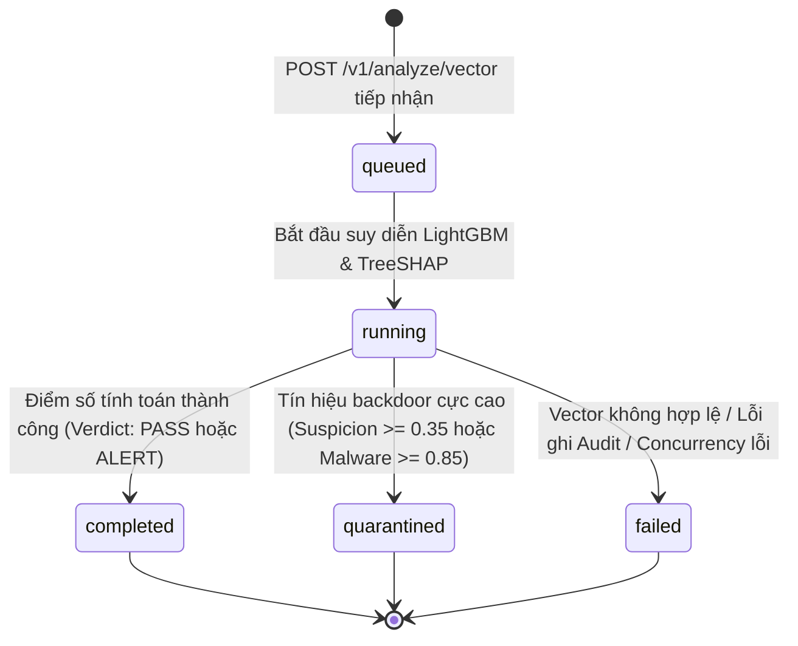
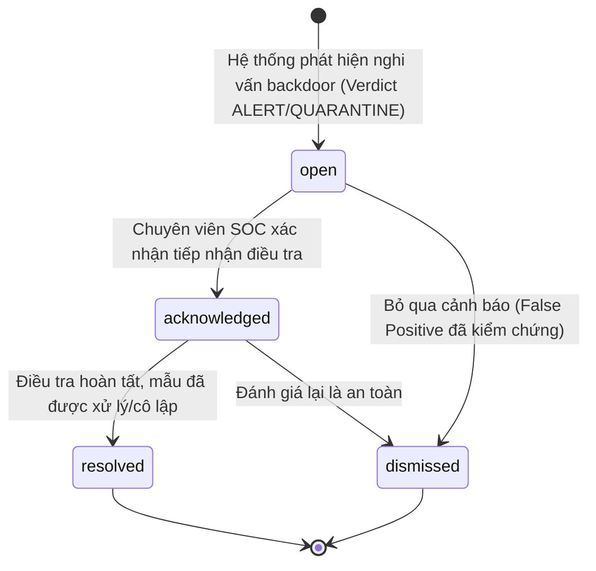
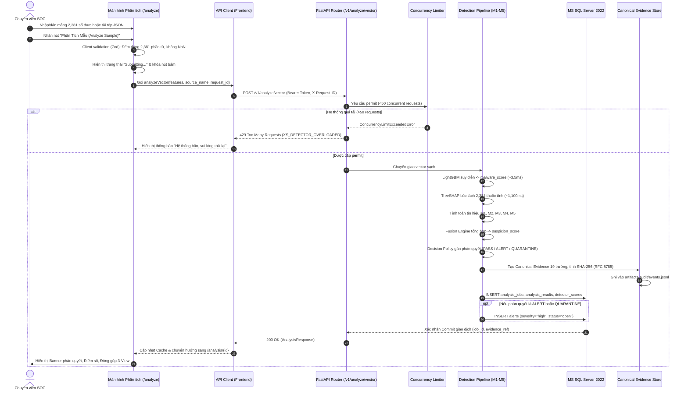
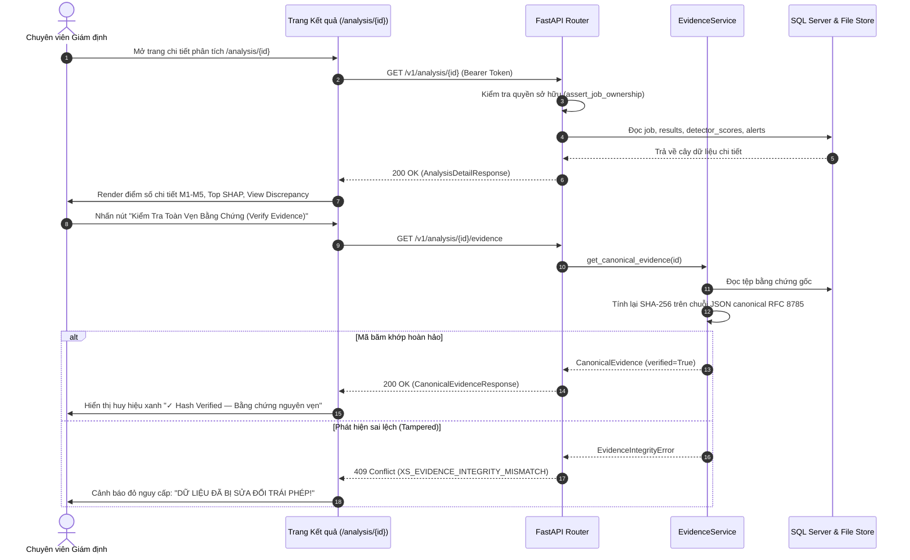
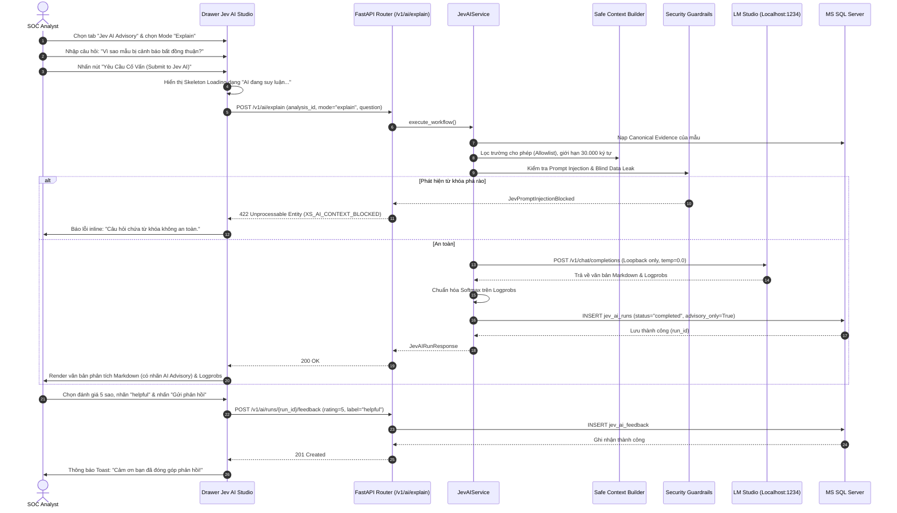
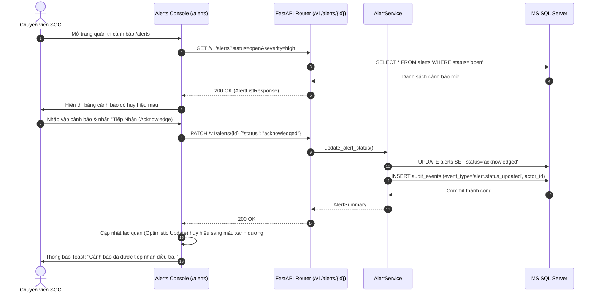

# X-SENTINEL V3 — PHÂN TÍCH VÀ ĐẶC TẢ LUỒNG NGHIỆP VỤ END-TO-END
## 06-BUSINESS-WORKFLOWS.md — End-to-End Business Workflows & Sequence Diagrams

> **Mục tiêu:** Tái dựng chi tiết 8 luồng nghiệp vụ người dùng cốt lõi từ mã nguồn thực tế, kèm sơ đồ tương tác tuần tự (Sequence Diagrams), máy trạng thái (State Machines) và kịch bản phục hồi lỗi ngoại lệ.

---

## 1. MÁY TRẠNG THÁI NGHIỆP VỤ (CORE STATE MACHINES)

Trong hệ thống X-SENTINEL V3, có 2 thực thể sở hữu vòng đời chuyển dịch trạng thái có điều kiện:

### 1.1. Vòng Đời Tác Vụ Phân Tích (`AnalysisJob` Lifecycle)

### 1.2. Vòng Đời Cảnh Báo An Ninh SOC (`Alert` Lifecycle)

---

## 2. CHI TIẾT 8 LUỒNG NGHIỆP VỤ CỐT LÕI (END-TO-END WORKFLOWS)

---

### WF-01: Luồng Nạp Vector & Phân Tích Phát Hiện Backdoor (Vector Analysis Flow)

- **Điểm bắt đầu:** Chuyên viên mở trang `/analyze`.
- **Hành động:** Dán mảng JSON hoặc tải tệp vector `.json`. Nhấn nút "Analyze".
- **API thực hiện:** `POST /v1/analyze/vector`.
- **Dữ liệu đọc/ghi:** Ghi mới 1 hàng trong `analysis_jobs`, 1 hàng trong `analysis_results`, 5 hàng trong `detector_scores`, 1 hàng trong `alerts` (nếu có nghi vấn), 1 dòng trong tệp `events.jsonl`.
- **Thay đổi trạng thái:** Tạo mới `job` ở trạng thái `completed` (hoặc `quarantined`).
- **Phản hồi:** Trả về đối tượng `AnalysisResponse`.
- **Cập nhật UI:** Chuyển sang màn hình Kết quả `/analysis/{id}`, hiển thị phán quyết màu sắc rõ ràng (Xanh/Cam/Đỏ), bảng M1–M5, biểu đồ 3-View và nút xuất JSON bằng chứng.
- **Kịch bản thất bại:** 
  - Nếu độ dài vector sai: Báo lỗi inline đỏ ngay dưới ô nhập liệu "Vector phải chứa đúng 2.381 phần tử số thực".
  - Nếu mạng rớt giữa chừng: Hiển thị nút "Thử lại (Retry)" giữ nguyên dữ liệu đã nhập.

---

### WF-02: Luồng Giám Định Chuyên Sâu & Kiểm Tra Bằng Chứng (Forensic Inspection Flow)

- **Điểm bắt đầu:** Nhấp vào một dòng trong danh sách Lịch sử hoặc sau khi phân tích xong.
- **Hành động:** Xem các biểu đồ phân tích SHAP và nhấn nút "Tải Bằng Chứng Pháp Chứng (Download Evidence JSON)".
- **API thực hiện:** `GET /v1/analysis/{id}/evidence`.
- **Xử lý Backend:** Đọc tệp `.jsonl`, tính toán băm SHA-256 trên nội dung theo chuẩn RFC 8785 và so khớp với mã băm đã lưu trữ.
- **Phản hồi:** Trả về đối tượng `CanonicalEvidenceResponse` 19 trường.
- **Cập nhật UI:** Trình duyệt tải về tệp `{request_id}_evidence.json` định dạng chuẩn.

---

### WF-03: Luồng Phân Tích Cố Vấn Jev AI & Gửi Đánh Giá (Jev AI Advisory Loop)

- **Bất biến sống còn:** Lời văn của AI được lưu trữ độc lập trong bảng `jev_ai_runs`. Nó không bao giờ được phép chỉnh sửa kết quả trong `analysis_results`.
- **Xử lý khi LM Studio tắt:** Backend trả về HTTP 503 `XS_AI_UNAVAILABLE`. Giao diện hiển thị thông báo nhẹ nhàng trong panel AI: *"Trợ lý Jev AI hiện đang offline (LM Studio chưa khởi chạy). Kết quả phát hiện của lõi toán học vẫn có hiệu lực 100%."*

---

### WF-04: Luồng Xử Lý & Chuyển Đổi Vòng Đời Cảnh Báo SOC (SOC Alert Management)

- **Quyền hạn:** Chỉ `Analyst` và `Admin` mới thấy nút chuyển trạng thái. Vai trò `Operator` chỉ thấy nhãn chỉ đọc (Read-only Badge).
- **Tính năng an toàn & Ghi chú Dismiss:** Mọi thao tác đổi trạng thái đều được hệ thống tự động ghi nhật ký vào bảng `audit_events` phục vụ thanh tra. Đối với hành động bỏ qua cảnh báo ("Dismiss"), giao diện yêu cầu chuyên viên nhập lý do giải trình tối thiểu 20 ký tự (ràng buộc UX Client-side `GAP-15` phòng tránh nhầm lẫn). Ghi chú này chỉ lưu trong In-Memory State phiên làm việc để bảo mật, không lưu vào unencrypted localStorage. Payload gửi lên Backend qua `PATCH /v1/alerts/{id}` tuân thủ nghiêm ngặt schema Backend và chỉ chứa `{"status": "dismissed"}` (Backend không lưu trường lý do giải trình).

---

### WF-05: Luồng Tìm Kiếm & Lọc Lịch Sử Đa Tiêu Chí (Forensic History Filtering)

- **Điểm bắt đầu:** Người dùng mở menu "History" (`/history`).
- **Hành động:** 
  1. Chọn bộ lọc: Quyết định = `ALERT`, Chế độ nạp = `vector`, Trạng thái = `completed`.
  2. Nhập từ khóa tìm kiếm: Mã `request_id`.
  3. Chọn số lượng dòng: 25 dòng/trang.
- **API thực hiện:** `GET /v1/analysis?limit=25&offset=0&decision=alert&input_mode=vector&status=completed`.
- **Backend xử lý:** `HistoryService.list_history()`. Nếu người dùng không phải Admin, tự động chèn thêm điều kiện `user_id = current_user.id` (Chống rò rỉ dữ liệu chéo người dùng).
- **Phản hồi:** Danh sách tóm tắt kèm tổng số lượng bản ghi `total`.
- **Cập nhật UI:** Render bảng dữ liệu với số trang tương ứng. Nhấp vào bất kỳ dòng nào sẽ điều hướng mượt mà sang `/analysis/{id}`.

---

### WF-06: Luồng Giám Sát Sức Khỏe & Đo Lường Phần Cứng (System Telemetry Flow)

- **Điểm bắt đầu:** Mở trang "System Status" (`/system/status`).
- **Hành động:** Chuyên viên vận hành mở tab "Hardware Telemetry & Metrics".
- **API thực hiện:** Gọi song song:
  - `GET /health` & `GET /ready` (Liveness & Readiness).
  - `GET /v1/config/status` (Phiên bản CSDL và tham số hệ thống).
  - `GET /v1/system/telemetry` (Yêu cầu quyền Operator hoặc Admin).
- **Backend xử lý:** Đọc thông số thực tế từ OS qua thư viện `psutil` (tỷ lệ CPU, RAM sử dụng, kích thước bộ nhớ RSS của tiến trình Backend, số lượng luồng).
- **Cập nhật UI:** Hiển thị Dashboard quản trị với các biểu đồ Gauge thời gian thực: Tải CPU (%), Bộ nhớ đã dùng (MB), Tình trạng kết nối CSDL SQL Server và phiên bản Alembic.

---

### WF-07: Luồng Trải Nghiệm Tải Tệp PE Thô Bị Khóa An Toàn (Raw PE Gated Experience)

- **Điểm bắt đầu:** Chuyên viên mở tab "Raw Binary (PE/EXE)" tại trang `/analyze`.
- **Trải nghiệm UI:** 
  - Khung kéo thả tệp bị làm mờ (opacity: 0.6) có biểu tượng ổ khóa an toàn màu xám.
  - Văn bản chú thích: *"Chức năng phân tích tệp nhị phân thô đang ở chế độ Gated (Pha 2) theo phê duyệt an toàn của CCB. Vui lòng chuyển sang tab 'EMBER Vector' để nạp đặc trưng số đã trích xuất."*
  - Nếu người dùng cố tình gửi request bằng công cụ ngoài (cURL/Postman) tới `POST /v1/analyze/file`: Backend lập tức trả về `HTTP 501 Not Implemented (XS_FEATURE_DISABLED)`.
  - Frontend bắt lỗi 501 và hiển thị Modal giải thích lý do an toàn, không để người dùng hoang mang.

---

### WF-08: Kịch Bản Xử Lý Sự Cố & Phục Hồi Lỗi (Exception & Chaos Recovery)

| Tình huống sự cố | Phản hồi của Backend | Hành vi phục hồi bắt buộc của Frontend |
|---|---|---|
| **Người dùng F5 refresh trang khi đang phân tích** | Request vẫn tiếp tục chạy trên Backend nhờ transaction độc lập | Khi tải lại trang, nếu có lưu `request_id` trong Session, Frontend tự động gọi `GET /v1/analysis/{request_id}` để lấy lại kết quả đã xong mà không phân tích lại. |
| **Gửi trùng `request_id` (Double Submit)** | `HTTP 409 Conflict` (`XS_DUPLICATE_REQUEST`) | Khóa nút Submit ngay khi nhấn lần 1. Nếu nhận lỗi 409, tự động chuyển hướng người dùng sang trang xem chi tiết của bản ghi đã tồn tại đó. |
| **Hệ thống chịu tải đột biến (>50 requests)** | `HTTP 429 Too Many Requests` (`XS_DETECTOR_OVERLOADED`) | Hiển thị Banner cảnh báo màu cam: *"Máy chủ đang xử lý hàng đợi tải cao, hệ thống sẽ tự động thử lại sau 5 giây..."* kèm thanh đếm ngược và tự động retry (tối đa 3 lần). |
| **LM Studio bị sập hoặc quá tải** | `HTTP 503` hoặc `HTTP 504` (`XS_AI_UNAVAILABLE` / `XS_AI_TIMEOUT`) | Giữ nguyên 100% kết quả phân tích toán học trên màn hình. Trong khung Jev AI, hiển thị thông báo offline và nút "Thử kết nối lại AI". Tuyệt đối không xóa kết quả máy. |
| **Mất kết nối Internet / Mạng nội bộ ngắt** | `NetworkError` / `ERR_CONNECTION_REFUSED` | Hiển thị thanh thông báo Offline ở đầu trang. Tạm dừng các bộ đếm polling ngầm để tránh gây nghẽn trình duyệt. |
