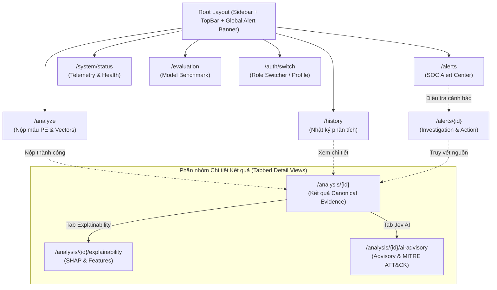

# 07 — DANH MỤC TRANG FRONTEND (FRONTEND PAGE INVENTORY)
## HỆ THỐNG X-SENTINEL V3 — MALWARE ANALYSIS & THREAT DETECTION PLATFORM

---

### MỤC LỤC
1. [Tổng quan Kiến trúc Điều hướng & Sơ đồ Tuyến đường (Route Hierarchy)](#1-tổng-quan-kiến-trúc-điều-hướng--sơ-đồ-tuyến-đường-route-hierarchy)
2. [Bảng ma trận Phân quyền & Điều kiện Truy cập Trang](#2-bảng-ma-trận-phân-quyền--điều-kiện-truy-cập-trang)
3. [Đặc tả Chi tiết Danh mục 10 Trang Frontend Chính thức](#3-đặc-tả-chi-tiết-danh-mục-10-trang-frontend-chính-thức)
   - [P01 — `/analyze` (Nộp Mẫu Phân Tích PE)](#p01--analyze-nộp-mẫu-phân-tích-pe)
   - [P02 — `/analysis/{id}` (Tổng quan Kết Quả Phân Tích & Canonical Evidence)](#p02--analysisid-tổng-quan-kết-quả-phân-tích--canonical-evidence)
   - [P03 — `/analysis/{id}/explainability` (Giải trình Mô hình AI: SHAP & Features)](#p03--analysisidexplainability-giải-trình-mô-hình-ai-shap--features)
   - [P04 — `/analysis/{id}/ai-advisory` (Khuyến nghị Cố vấn Bảo mật Jev AI)](#p04--analysisidai-advisory-khuyến-nghị-cố-vấn-bảo-mật-jev-ai)
   - [P05 — `/history` (Nhật ký & Lịch sử Phân tích Mẫu)](#p05--history-nhật-ký--lịch-sử-phân-tích-mẫu)
   - [P06 — `/alerts` (Trung tâm Quản trị Cảnh báo Đe dọa SOC)](#p06--alerts-trung-tâm-quản-trị-cảnh-báo-đe-dọa-soc)
   - [P07 — `/alerts/{id}` (Quy trình Điều tra & Xử lý Chi tiết Cảnh báo)](#p07--alertsid-quy-trình-điều-tra--xử-lý-chi-tiết-cảnh-báo)
   - [P08 — `/system/status` (Giám sát Authentic Telemetry & Sức khỏe Node)](#p08--systemstatus-giám-sát-authentic-telemetry--sức-khỏe-node)
   - [P09 — `/evaluation` (Đánh giá Hiệu năng Mô hình & Benchmark Matrix)](#p09--evaluation-đánh-giá-hiệu-năng-mô-hình--benchmark-matrix)
   - [P10 — `/auth/switch` (Chuyển đổi Danh tính / Dev Role Switcher)](#p10--authswitch-chuyển-đổi-danh-tính--dev-role-switcher)
4. [Quy ước Điều hướng & Trạng thái Toàn cục (Global Navigation Rules)](#4-quy-ước-điều-hướng--trạng-thái-toàn-cục-global-navigation-rules)

---

### 1. TỔNG QUAN KIẾN TRÚC ĐIỀU HƯỚNG & SƠ ĐỒ TUYẾN ĐƯỜNG (ROUTE HIERARCHY)

Hệ thống Frontend X-SENTINEL V3 được thiết kế theo cấu trúc điều hướng phân cấp (Hierarchical Routing) dành riêng cho ứng dụng Single-Page Application (Next.js App Router hoặc React Router v6), tối ưu hóa luồng thao tác của Chuyên gia Phân tích SOC (Security Operations Center), Kỹ sư An toàn thông tin và Quản trị viên hệ thống.

---

### 2. BẢNG MA TRẬN PHÂN QUYỀN & ĐIỀU KIỆN TRUY CẬP TRANG

| Route ID | Tuyến đường (Path) | Tên màn hình | Quyền tối thiểu (RBAC) | Vai trò hợp lệ | Bảo vệ BOLA/IDOR | Điều kiện chuyển hướng nếu lỗi |
|:---|:---|:---|:---|:---|:---|:---|
| **P01** | `/analyze` | Nộp Phân Tích Mẫu | `analysis:submit` | `operator`, `analyst`, `admin` | Không | 403 Forbidden nếu là `evaluator` (Role evaluator bị cô lập, không có quyền submit) |
| **P02** | `/analysis/{id}` | Chi tiết Phân Tích | `analysis:read` | `analyst`, `admin`, `evaluator`, `operator` | **Có** (`user_id == current_user` hoặc `role == admin`) | 403 Forbidden nếu không sở hữu Job ID |
| **P03** | `/analysis/{id}/explainability` | Giải trình SHAP | `analysis:read` | `analyst`, `admin`, `evaluator`, `operator` | **Có** (`assert_job_ownership`) | 403 Forbidden nếu không sở hữu Job ID |
| **P04** | `/analysis/{id}/ai-advisory` | Khuyến nghị Jev AI | `ai:read` (xem), `ai:invoke` (gọi) | `analyst`, `admin` | **Có** (`assert_job_ownership`) | Ẩn tab nếu là `operator` hoặc `evaluator` |
| **P05** | `/history` | Lịch sử Phân Tích | `analysis:read` | `analyst`, `admin`, `evaluator`, `operator` | Dữ liệu lọc theo User (`admin` xem toàn bộ) | Đưa về trang login/switch nếu chưa có token |
| **P06** | `/alerts` | Trung tâm Cảnh báo | `alerts:read` | `analyst`, `admin`, `operator` | Không (dữ liệu alert tổ chức theo tenant) | 403 nếu vai trò là `evaluator` |
| **P07** | `/alerts/{id}` | Xử lý Cảnh báo | `alerts:mutate` (để sửa), `alerts:read` (để xem) | `analyst`, `admin` (xem/sửa), `operator` (chỉ xem) | Không | 403 nếu `operator` bấm nút cập nhật trạng thái |
| **P08** | `/system/status` | Giám sát Hệ thống | Route Role: `admin`, `operator` (`admin:ops`*) | `admin`, `operator` | Không | 403 nếu `analyst`, `evaluator` truy cập trực tiếp (*Route yêu cầu role; operator truy cập qua route check) |
| **P09** | `/evaluation` | Benchmark Mô hình [DESIGN_ONLY] | `evaluation:score` | `evaluator`, `admin` | Không | 403 nếu `analyst`, `operator` truy cập |
| **P10** | `/auth/switch` | Quản lý Phiên & Dev Auth | Bất kỳ ai có Bearer token hợp lệ | `admin`, `analyst`, `operator`, `evaluator` | Không | Cho phép chuyển token dev nhanh |

---

### 3. ĐẶC TẢ CHI TIẾT DANH MỤC 10 TRANG FRONTEND CHÍNH THỨC

#### P01 — `/analyze` (NỘP MẪU PHÂN TÍCH PE)
- **Tuyến đường:** `/analyze`
- **Mục đích nghiệp vụ:** Cho phép chuyên viên SOC nộp mẫu thực thi PE dưới dạng Feature Vector 2.381 chiều EMBER 2018 (hoặc kiểm tra trạng thái tệp nhị phân thô bị khóa 501) để hệ thống tiến hành kiểm thực, phân rã 3-view, suy luận LightGBM/TreeSHAP, đánh giá qua 5 module chuyên biệt (M1-M5) và đưa ra phán quyết pháp chứng có mã băm bảo toàn chứng cứ (`evidence_hash`).
- **Các thành phần UI chính:**
  1. *Tabs Lựa chọn Phương thức Nộp:* Tab 1: "2,381-Dimensional Feature Vector (Khuyên dùng)", Tab 2: "File SHA-256 / File Upload (Disabled)", Tab 3: "Dữ liệu Mẫu Thử nghiệm (Sample Benchmarks)".
  2. *Khung Cảnh báo Vô hiệu hóa Upload Tệp nhị phân thô:* Alert banner màu hổ phách giải thích mã lỗi HTTP 501 `XS_FEATURE_DISABLED` theo chính sách an toàn thông tin cách ly mã độc nhị phân trực tiếp.
  3. *Form Nhập Vector 2.381 Chiều:* Form hỗ trợ 2 chế độ:
     - Nhập trực tiếp JSON Array đúng 2.381 phần tử số thực float hữu hạn.
     - Bộ nạp mẫu ngẫu nhiên (Load Benign Sample / Load Ransomware Sample / Load Trojan Sample) từ tập fixture chuẩn hóa.
  4. *Trường tùy chọn Nâng cao:* Checkbox "Kích hoạt Phân tích Chuyên sâu Jev AI (Sinh báo cáo khuyến nghị)", Dropdown chọn Mức độ Ưu tiên (Normal / High / Emergency).
  5. *Khu vực Nút hành động:* Primary CTA "Tiến hành Phân tích Mẫu (Run Analysis)", Secondary Button "Xóa trắng Form (Reset)".
- **API Backend phụ thuộc:**
  - `POST /v1/analyze/vector` (Primary Endpoint — thực thi đồng bộ trả về kết quả ngay lập tức)
  - `POST /v1/analyze/file` (Hiển thị trạng thái 501 `XS_FEATURE_DISABLED`)
- **Các trạng thái tương tác:**
  - *Default:* Form rỗng, các trường kiểm tra hiển thị placeholder hướng dẫn.
  - *Submitting:* Primary CTA chuyển sang Spinner, toàn bộ form bị disable.
  - *Error:* Hiển thị inline validation viền đỏ (nếu mảng không đủ 2.381 phần tử hoặc chứa giá trị không hợp lệ NaN/Inf), hoặc Banner đỏ thông báo `XS_DETECTOR_OVERLOADED` (HTTP 429) kèm nút thử lại sau 5 giây.
  - *Success:* Tự động chuyển trang sang `/analysis/{id}` kèm Toast thông báo thành công.

---

#### P02 — `/analysis/{id}` (TỔNG QUAN KẾT QUẢ PHÂN TÍCH & CANONICAL EVIDENCE)
- **Tuyến đường:** `/analysis/{id}`
- **Tham số URL:** `id` (UUIDv4 của Analysis Job)
- **Mục đích nghiệp vụ:** Màn hình trung tâm hiển thị Bằng chứng Chuẩn mực (Canonical Evidence) của một mẫu mã độc đã được phân tích. Là căn cứ pháp lý và kỹ thuật duy nhất để xác định tính độc hại của mẫu PE, bao gồm Phán quyết Độc quyền (PASS / ALERT / QUARANTINE / DEMO_ONLY), Điểm số mã độc LightGBM (`malware_score`), Điểm nghi vấn Backdoor Fused (`suspicion_score`), Chi tiết 5 Detector (M1-M5), Đóng góp 3 Semantic Views và Mã băm Bằng chứng SHA-256 (`evidence_hash`).
- **Các thành phần UI chính:**
  1. *Header Báo cáo:* Job UUID, Thời gian phân tích (UTC + Local), Trạng thái thực thi (`completed`, `failed`, `quarantined`, `running`, `queued`), Nút tải về Báo cáo JSON (`Download Raw Evidence JSON`).
  2. *Verdict Hero Card (Thẻ Phán Quyết Độc Tôn):*
     - Huy hiệu Phán quyết lớn với màu sắc phân cấp rõ rệt: Đỏ đậm (`QUARANTINE`), Hổ phách rực rỡ (`ALERT`), Xanh lá ngọc lục bảo (`PASS`), Tím xám (`DEMO_ONLY`).
     - Chỉ số Nghi vấn Backdoor (`suspicion_score`) và Điểm mã độc (`malware_score`) kèm ngưỡng hiệu chuẩn D0/D1.
     - Mã Băm Bằng chứng Bất biến (`evidence_hash`) hiển thị dạng khối mật mã với nút Sao chép 1-Click (`Copy SHA-256`).
  3. *Ensemble Modules Breakdown (Bảng Phân rã 5 Module M1-M5):*
     - Bảng so sánh điểm số và chẩn đoán của từng module:
       - M1: TADR (Attribution Dominance Ratio)
       - M2: Tabular STRIP (Shannon Entropy pha trộn)
       - M3: View Concentration (Đóng góp View)
       - M4: Cross-View Disagreement (Bất đồng thuận View)
       - M5: Semantic Plausibility Rules (Quy tắc ngữ nghĩa PE)
  4. *Tab Navigation Bar liên kết nội bộ:*
     - Tab 1: "Tổng quan Kết quả (Overview)" (Đang chọn)
     - Tab 2: "Giải trình Mô hình (Explainability & SHAP)" -> Chuyển sang P03
     - Tab 3: "Cố vấn Bảo mật Jev AI (Advisory)" -> Chuyển sang P04 (Kèm badge cảnh báo `Advisory Only`)
  5. *BOLA Ownership Badge:* Thẻ thông tin hiển thị chủ sở hữu job (`user_id`), xác nhận tính bảo mật cách ly giữa các chuyên viên SOC.
- **API Backend phụ thuộc:**
  - `GET /v1/analysis/{id}` (Lấy kết quả Canonical & điểm M1-M5)
  - `GET /v1/analysis/{id}/evidence` (Lấy gói bằng chứng RFC 8785)
- **Các trạng thái tương tác:**
  - *Loading:* Skeleton layout mô phỏng cấu trúc Verdict Hero Card và bảng Module trong khi tải dữ liệu từ `GET /v1/analysis/{id}`. (Do phân tích vector chạy đồng bộ, không cần cơ chế polling status).
  - *Forbidden (HTTP 403):* Trang Báo lỗi BOLA/IDOR thông báo chuyên viên không có quyền truy cập vào phiên phân tích của đồng nghiệp khác (`assert_job_ownership`).
  - *Not Found (HTTP 404):* Giao diện Empty State báo Job ID không tồn tại trên hệ thống.

---

#### P03 — `/analysis/{id}/explainability` (GIẢI TRÌNH MÔ HÌNH AI: SHAP & FEATURES)
- **Tuyến đường:** `/analysis/{id}/explainability`
- **Tham số URL:** `id` (UUIDv4 của Analysis Job)
- **Mục đích nghiệp vụ:** Cung cấp khả năng giải trình (Explainable AI - XAI) minh bạch cho kết quả suy luận của mô hình học máy. Hiển thị đóng góp của 3 góc nhìn ngữ nghĩa (Structural: 461, Behavioral: 1.342, Metadata: 578) và chẩn đoán 5 detector tín hiệu (M1-M5).
- **QUY TẮC BẤT BIẾN KHẢ DỤNG DỮ LIỆU (DATA AVAILABILITY INVARIANT):**
  - **Dữ liệu Backend Khả dụng Thực tế:** `GET /v1/analysis/{id}` trả về `view_contributions` (`structural`, `behavioral`, `metadata`), `verdict`, `malware_score`, `suspicion_score` và mảng chẩn đoán 5 module `scores` (M1: TADR, M2: Tabular STRIP, M3: View Concentration, M4: Cross-View Disagreement, M5: Semantic Rules).
  - **Dữ liệu Chưa Khả dụng (DESIGN_ONLY / BACKEND_GAP):** Biểu đồ thác nước (Waterfall plot) và bảng bóc tách chi tiết Top 15 đặc trưng cá nhân kèm giá trị trọng số SHAP cụ thể hiện tại **chưa có HTTP API cung cấp** từ Backend. Frontend hiển thị thành phần này dưới dạng Design Mock / Fallback trực quan kèm badge giải thích `[MOCK / DESIGN_ONLY — Đang chờ API XAI bóc tách đặc trưng chi tiết]`.
- **Các thành phần UI chính:**
  1. *Waterfall Plot / Bar Chart Biểu diễn Giá trị SHAP [MOCK / DESIGN_ONLY]:*
     - Biểu đồ thanh ngang (Horizontal Bar Chart) hiển thị Top 15 đặc trưng có trọng số SHAP dương (đẩy kết luận về phía Độc hại) và SHAP âm (đẩy kết luận về phía An toàn) dựa trên dữ liệu mẫu minh họa.
     - Đường chuẩn Baseline (Expected Value của mô hình LightGBM).
  2. *Bảng Tra cứu Top Đặc trưng SHAP & 2.381 Chiều PE [MOCK / DESIGN_ONLY]:*
     - Danh sách đặc trưng kèm tên chuẩn hóa (Canonical Feature Name), Giá trị thô (Raw Value), Giá trị Chuẩn hóa (Normalized Value) và Trọng số SHAP minh họa.
     - Ô tìm kiếm lọc nhanh theo tên trường (vd: `entropy`, `virtual_size`, `imports`).
  3. *Khung Đóng Góp 3-View (Authentic Backend Data):* Tỷ lệ phần trăm đóng góp thực tế của Structural, Behavioral và Metadata View lấy từ `view_contributions`.
- **API Backend phụ thuộc:**
  - `GET /v1/analysis/{id}` (Trích xuất `view_contributions`, `scores` diagnostics)
- **Các trạng thái tương tác:**
  - *Empty State:* Nếu mô hình chạy ở chế độ thu gọn (Fast Mode không tính SHAP), hiển thị thông báo "Dữ liệu SHAP không được kích hoạt cho phiên phân tích này" kèm nút yêu cầu phân tích lại với chế độ XAI.
  - *Interactive Chart:* Hover vào từng thanh biểu đồ để xem định nghĩa toán học và công thức chuẩn hóa của đặc trưng.

---

#### P04 — `/analysis/{id}/ai-advisory` (KHUYẾN NGHỊ CỐ VẤN BẢO MẬT JEV AI)
- **Tuyến đường:** `/analysis/{id}/ai-advisory`
- **Tham số URL:** `id` (UUIDv4 của Analysis Job)
- **Mục đích nghiệp vụ:** Hiển thị nhận định phân tích định tính và đề xuất phản ứng sự cố do Trợ lý AI Cố vấn Bảo mật Jev AI (sử dụng mô hình ngôn ngữ lớn LLM tích hợp qua LM Studio) tự động sinh ra.
- **BẤT BIẾN THIẾT KẾ BẮT BUỘC (CRITICAL UI INVARIANT):**
  - Màn hình này **BẮT BUỘC** hiển thị Banner Cảnh báo nổi bật màu hổ phách viền đậm ở vị trí trên cùng:
    `[KHUYẾN NGHỊ THAM KHẢO DUY NHẤT] Nội dung dưới đây do Jev AI tổng hợp tự động nhằm mục đích hỗ trợ định hướng điều tra sự cố. Nhận định này KHÔNG PHẢI là Phán quyết Độc quyền của Hệ thống và KHÔNG CÓ GIÁ TRỊ PHÁP LÝ thay thế Canonical Evidence.`
  - Toàn bộ khung giao diện Jev AI phải được bao bọc trong viền phân cách riêng biệt, cấm sử dụng cùng kiểu dáng với Thẻ Phán Quyết Độc Tôn ở trang P02.
- **Các thành phần UI chính:**
  1. *Jev AI Advisory Header Banner:* Huy hiệu `advisory_only: true`, Thông tin Model (`settings.jev_ai_model`, mặc định `jev-local-TBD` lấy động qua `GET /v1/ai/status`), Thời gian sinh nội dung, Token Usage Metrics.
  2. *Tóm lược Đánh giá Nguy cơ Tự nhiên (Natural Language Threat Narrative):* Báo cáo phân tích hành vi mã độc được định dạng Markdown chuẩn mực trích xuất từ trường `response_text`.
  3. *Ánh xạ Chiến thuật MITRE ATT&CK Matrix & Phân tích Độc quyền:*
     - Khung hiển thị ma trận kỹ thuật trích xuất từ văn bản nhận định và context phân tích.
     - Tên chiến thuật (Tactics: Defense Evasion, Discovery, Execution).
     - Mức độ tin cậy của phát hiện (Suspected / Confirmed).
  4. *Đề xuất Kế hoạch Cách ly & Ứng phó Sự cố (Incident Response Playbook):*
     - Checklist hành động theo thứ tự ưu tiên (P1: Cách ly máy trạm khỏi mạng LAN, P2: Quét SHA-256 trên toàn bộ SIEM/EDR, P3: Thu hồi chứng chỉ người dùng bị xâm phạm).
  5. *Nút Sinh lại Nhận định AI (Execute AI Advisory):* Nút hành động cho phép Chuyên viên SOC gửi yêu cầu suy luận cố vấn (`POST /v1/ai/explain`, khả dụng với quyền `ai:invoke` của vai trò `admin`, `analyst`).
  6. *Đánh giá Phản hồi Nhận định AI (Feedback Component):* Bộ đánh giá 1-5 sao và nhãn chất lượng (`helpful`, `not_helpful`, `incorrect`, `unsafe`, `unclear`) gửi tới `POST /v1/ai/runs/{run_id}/feedback`.
- **API Backend phụ thuộc:**
  - `POST /v1/ai/explain` (Kích hoạt luồng suy luận cố vấn Jev AI)
  - `GET /v1/ai/runs` (Truy vấn danh sách lượt chạy Jev AI theo analysis_id)
  - `GET /v1/ai/runs/{run_id}` (Lấy chi tiết phản hồi nhận định Markdown của một run)
  - `POST /v1/ai/runs/{run_id}/feedback` (Gửi đánh giá rating 1-5 sao và nhãn phản hồi)
  - `GET /v1/ai/runs/{run_id}/feedback` (Lấy danh sách đánh giá của lượt chạy)
- **Các trạng thái tương tác:**
  - *Generating AI Response:* Skeleton dạng đoạn văn bản nhấp nháy kèm huy hiệu trạng thái: `Jev AI đang phân tích dữ liệu... (Hàng đợi: 2/16)`.
  - *AI Service Unavailable (HTTP 503 `XS_AI_UNAVAILABLE`):* Thẻ cảnh báo xám thông báo Engine LM Studio nội bộ đang ngoại tuyến, không làm ảnh hưởng đến tính toàn vẹn của kết quả Canonical ở trang P02.

---

#### P05 — `/history` (NHẬT KÝ & LỊCH SỬ PHÂN TÍCH MẪU)
- **Tuyến đường:** `/history`
- **Mục đích nghiệp vụ:** Cung cấp bảng dữ liệu toàn diện về toàn bộ các phiên phân tích mã độc đã thực hiện trong hệ thống, phục vụ tra cứu, kiểm toán điều tra và đối soát chứng cứ.
- **Các thành phần UI chính:**
  1. *Thanh Công cụ Lọc Đa tiêu chí (Multi-criteria Filter Toolbar):*
     - Bộ lọc Phán quyết (DecisionVerdict: `All`, `PASS`, `ALERT`, `QUARANTINE`, `DEMO_ONLY`).
     - Bộ lọc Trạng thái Job (JobStatus: `All`, `queued`, `running`, `completed`, `failed`, `quarantined`).
     - Bộ lọc Phương thức đầu vào (Input Mode: `All`, `vector`, `raw_pe`).
     - Cờ Demo Mode: Tách biệt cờ `demo_mode` (boolean) khỏi phán quyết; cho phép lọc độc lập các phiên thử nghiệm.
     - *Phân định Server-side vs Client-side:* Các tham số `limit`, `offset`, `status`, `decision`, `input_mode`, `demo_mode` được gửi trực tiếp lên Backend query parameters của `GET /v1/analysis`. Bộ chọn khoảng thời gian (Date Range Picker) và ô tìm kiếm toàn văn text search được thực hiện tại tầng Client-side trên tập kết quả tải về.
  2. *Bảng Dữ liệu Phân tích (Analysis Jobs Data Table):*
     - Cột 1: Mã Job ID (Kèm biểu tượng copy nhanh).
     - Cột 2: Thời gian tạo (Định dạng tương đối, ví dụ: `15 phút trước`).
     - Cột 3: Phán quyết (Huy hiệu có màu sắc theo tiêu chuẩn).
     - Cột 4: Điểm tin cậy (Thanh tiến trình mini hiển thị % số).
     - Cột 5: Mã băm Bằng chứng (`evidence_hash` thu gọn 8 ký tự đầu/cuối).
     - Cột 6: Chuyên viên phân tích (`user_id`).
     - Cột 7: Thao tác (Nút xem chi tiết `View`, Nút tải báo cáo `Export JSON`).
  3. *Thanh Phân trang Chuẩn mực (Pagination Controls):*
     - Hiển thị tổng số dòng (`Hiển thị 1-20 trong tổng số 1,420 kết quả`).
     - Lựa chọn kích thước trang (10, 20, 50, 100 dòng/trang).
     - Nút Chuyển trang (Previous, Next, Nhập số trang trực tiếp).
  4. *Công cụ Xuất Dữ liệu (Bulk Export):* Nút xuất toàn bộ danh sách kết quả đã lọc ra định dạng CSV hoặc JSON phục vụ báo cáo ban lãnh đạo.
- **API Backend phụ thuộc:**
  - `GET /v1/analysis` (Lấy danh sách job kèm phân trang `limit`, `offset` và bộ lọc server-side `status`, `decision`, `input_mode`, `demo_mode`)
- **Các trạng thái tương tác:**
  - *Empty State:* Minh họa trực quan kèm nút bấm gợi ý "Nộp mẫu phân tích đầu tiên ngay" dẫn tới `/analyze`.
  - *Loading:* Skeleton 10 dòng bảng kèm thanh header mờ.

---

#### P06 — `/alerts` (TRUNG TÂM QUẢN TRỊ CẢNH BÁO ĐE DỌA SOC)
- **Tuyến đường:** `/alerts`
- **Mục đích nghiệp vụ:** Bảng điều khiển tác chiến dành cho đội ngũ SOC L1/L2/L3 để giám sát các cảnh báo an ninh được tự động kích hoạt khi hệ thống phát hiện mẫu PE có mức độ nguy hại cao (`severity: CRITICAL` hoặc `HIGH`).
- **Các thành phần UI chính:**
  1. *Metric Summary Cards (4 Thẻ Chỉ số Phân cấp - Phạm vi Trang Hiện Tại / Current Page Scope):*
     > [!NOTE]
     > Backend `GET /v1/alerts` trả về danh sách phân trang (`limit`, `offset`) và không có endpoint aggregate toàn cục cho cảnh báo. Do đó 4 thẻ chỉ số được tính toán client-side trên phạm vi trang hiện tại (Current Page Scope, mặc định 20 cảnh báo) để phản ánh dữ liệu thực tế, tránh hiểu lầm là tổng số liệu toàn hệ thống.
     - Tổng số Cảnh báo Hoạt động trên trang (Current Page Active Alerts).
     - Cảnh báo Mức Nghiêm trọng trên trang (Current Page Critical Severity - Viền đỏ rực).
     - Cảnh báo Đang Điều tra trên trang (Current Page In Investigation - Viền xanh dương).
     - Tỷ lệ Xử lý Thành công trên trang (Current Page Resolved Rate).
  2. *Bộ lọc Trạng thái Quy trình (Workflow Lifecycle Filters):*
     - Các tab trạng thái chuẩn hóa theo Backend: `Tất cả (All)`, `Mới kích hoạt (OPEN)`, `Đã tiếp nhận (ACKNOWLEDGED)`, `Đã giải quyết (RESOLVED)`, `Đã đóng/Bỏ qua (DISMISSED)`.
  3. *Bảng Quản lý Cảnh báo Đe dọa (Threat Alerts Table):*
     - Cột 1: Alert ID & Tiêu đề cảnh báo (vd: `Ransomware Behavior Detected on PE-Sample`).
     - Cột 2: Mức độ nghiêm trọng (`CRITICAL`, `HIGH`, `MEDIUM`, `LOW`).
     - Cột 3: Trạng thái quy trình (Pill badge có màu).
     - Cột 4: Nguồn phát hiện (Analysis Job ID liên kết).
     - Cột 5: Chuyên viên thụ lý (Assignee Avatar/Tên - hiển thị theo client-state).
     - Cột 6: Thời điểm kích hoạt & SLA đếm ngược.
     - Cột 7: Thao tác nhanh (Tiếp nhận `Acknowledge`, Xem chi tiết `Investigate`).
- **API Backend phụ thuộc:**
  - `GET /v1/alerts` (Lấy danh sách cảnh báo, tham số lọc theo severity, status, analysis_job_id)
  - `PATCH /v1/alerts/{id}` (Thao tác cập nhật trạng thái nhanh trên từng dòng: chỉ nhận `{ status: str }`)
- **Các trạng thái tương tác:**
  - *Realtime Pulse:* Chỉ báo đèn xanh nhấp nháy hiển thị cơ chế kiểm tra cảnh báo nền mỗi 15 giây.
  - *High-Severity Audio/Visual Ping:* Khi có cảnh báo `CRITICAL` mới xuất hiện, hàng trên cùng nhấp nháy viền đỏ vi tính để thu hút sự chú ý tức thì của ca trực.

---

#### P07 — `/alerts/{id}` (QUY TRÌNH ĐIỀU TRA & XỬ LÝ CHI TIẾT CẢNH BÁO)
- **Tuyến đường:** `/alerts/{id}`
- **Tham số URL:** `id` (UUIDv4 của Alert)
- **Mục đích nghiệp vụ:** Không gian làm việc chuyên sâu cho điều tra viên SOC để phân tích nguồn gốc cảnh báo, ghi chép nhật ký điều tra (`investigation notes`), đối chiếu mẫu mã độc gây ra cảnh báo và cập nhật trạng thái giải quyết triệt để.
- **Các thành phần UI chính:**
  1. *Alert Header & Status Stepper:*
     - Thanh tiến trình trạng thái trực quan hóa chu trình sống hợp lệ: `OPEN` -> `ACKNOWLEDGED` -> `RESOLVED` hoặc `DISMISSED`. (Lưu ý: `RESOLVED` và `DISMISSED` là trạng thái kết thúc/terminal; backend từ chối chuyển trạng thái nếu đã đóng).
     - Nút Chuyển đổi Trạng thái Kế tiếp (Next Stage CTA).
  2. *Thông tin Nguồn gốc Đe dọa (Threat Origin Panel):*
     - Khối liên kết trực tiếp tới Job phân tích gốc: Job UUID, Thời điểm phân tích, Phán quyết độc quyền, Mã bằng chứng `evidence_hash`.
     - Nút "Mở Hồ sơ Bằng chứng Gốc" (Dẫn thẳng sang trang P02 trong tab mới).
  3. *Form Thụ lý & Gán việc (Assignment & Triage Details) [UI GAP]:*
     - Trường chọn Người chịu trách nhiệm (Assignee Dropdown): *Chỉ lưu tại Client State / UI gap vì backend PATCH không có trường `assignee_id`.*
     - Trường phân loại nguyên nhân gốc rễ (Root Cause Category).
  4. *Khung Nhật ký Điều tra Sự cố (Investigation Timeline & Notes) [UI GAP - GAP-15]:*
     - Dòng thời gian hiển thị toàn bộ thay đổi trạng thái từ backend audit log.
     - Khung soạn thảo Ghi chú Điều tra (Markdown Notes Input): *Lưu tại Client In-Memory State (React/Zustand); backend PATCH không lưu `investigation_notes`. CẤM TUYỆT ĐỐI lưu vào unencrypted localStorage để phòng ngừa rò rỉ thông tin điều tra SOC.*
     - Nút "Lưu Ghi chú Điều tra (In-Memory Session Note)".
  5. *Dangerous Action Modal:* Khi chuyên viên chọn đóng cảnh báo với trạng thái `DISMISSED`, modal xác nhận yêu cầu nhập lý do kỹ thuật tối thiểu 20 ký tự (kiểm thực phía client trước khi gửi PATCH cập nhật status).
- **API Backend phụ thuộc:**
  - `GET /v1/alerts/{id}` (Chi tiết cảnh báo)
  - `PATCH /v1/alerts/{id}` (Cập nhật trạng thái duy nhất: `status` sang `acknowledged`, `resolved`, hoặc `dismissed`)
  - `GET /v1/analysis/{job_id}` (Truy vấn chéo dữ liệu job gốc)
- **Các trạng thái tương tác:**
  - *Read-only Mode:* Tự động kích hoạt đối với người dùng giữ vai trò `operator` (chỉ xem, các nút chuyển trạng thái bị vô hiệu hóa kèm tooltip giải thích quyền hạn).

---

#### P08 — `/system/status` (GIÁM SÁT AUTHENTIC TELEMETRY & SỨC KHỎE NODE)
- **Tuyến đường:** `/system/status`
- **Mục đích nghiệp vụ:** Bảng điều khiển quản trị hạ tầng hiển thị dữ liệu viễn trắc phần cứng thực tế (Authentic Telemetry) trích xuất trực tiếp từ hệ điều hành qua thư viện `psutil` của backend, loại bỏ hoàn toàn các chỉ số giả lập để đảm bảo độ tin cậy tuyệt đối khi vận hành hệ thống.
- **QUY TẮC BẤT BIẾN KHẢ DỤNG DỮ LIỆU TELEMETRY (P08 DATA AVAILABILITY INVARIANT):**
  - **Dữ liệu Backend Khả dụng Thực tế (`GET /v1/system/telemetry` từ `psutil`):**
    - `status`: `"ok"` hoặc `"degraded"`
    - `cpu`: `utilization_percent` (float), `logical_cores` (int | null), `physical_cores` (int | null)
    - `memory`: `total_bytes`, `available_bytes`, `used_bytes`, `used_percent` (float)
    - `process`: `pid` (int), `rss_bytes`, `vms_bytes`, `thread_count` (int)
  - **Dữ liệu Sức khỏe Probe (`GET /health`, `GET /ready`, `GET /v1/config/status`):** Trạng thái liveness/readiness, kết nối CSDL và phiên bản schema Alembic.
  - **Chỉ số Chưa Khả dụng / Khoảng trống Backend (`DESIGN_ONLY` / `BACKEND_GAP`):**
    - Tên máy chủ (Hostname), Tên Hệ điều hành (OS String), Thời gian hoạt động máy chủ (Server Uptime).
    - Thống kê chi tiết Database Connection Pool (ví dụ: `18/50 active connections`).
    - Số slot Concurrency thực tế (`concurrency_slots: 50`) và Độ sâu hàng đợi Jev AI (`queue: 0/16`).
    - *Quy tắc UI:* Các widget này được hiển thị dưới dạng ước tính tĩnh / design placeholder kèm nhãn `[DESIGN_ONLY / Chờ Telemetry v2]`, tuyệt đối không giả lập dữ liệu động đánh lừa chuyên viên vận hành.
- **Các thành phần UI chính:**
  1. *Node Identity & Engine Header:*
     - Phiên bản X-SENTINEL Engine (`3.0.0`), Trạng thái Node (`status` từ telemetry: `ok` / `degraded`).
     - Hostname & Server Uptime: Hiển thị nhãn `DESIGN_ONLY` / Placeholder.
  2. *Authentic Hardware Telemetry Grid (Bộ đo Phần cứng Thực tế 100% từ `psutil`):*
     - Đồng hồ CPU Usage (% thực tế thời gian thực `utilization_percent`, số lõi logic `logical_cores`, số lõi vật lý `physical_cores`).
     - Thanh đo RAM Usage (Dung lượng đã dùng `used_bytes`, Dung lượng khả dụng `available_bytes`, Tổng dung lượng `total_bytes`, Tỷ lệ `used_percent`).
     - Thông số Tiến trình Process (PID `pid`, Bộ nhớ thực `rss_bytes`, Bộ nhớ ảo `vms_bytes`, Số luồng `thread_count`).
  3. *Tình trạng Hoạt động Phân hệ Cốt lõi (Subsystems Health Check):*
     - **Database Engine (SQL Server 2022):** Trạng thái kết nối từ `/health` và `/ready`. (Chỉ số pool chi tiết là `DESIGN_ONLY`).
     - **Machine Learning Core (LightGBM & SHAP Engine):** Trạng thái nạp mô hình từ `/ready`.
     - **Jev AI Advisory Engine (LM Studio Local Endpoint):** Trạng thái khả dụng từ `/health` dependencies (`ok` / `degraded`). (Độ sâu hàng đợi là `DESIGN_ONLY`).
  4. *Prometheus Metrics Link & Live Raw Telemetry Inspector:*
     - Khung JSON Viewer hiển thị dữ liệu thô từ endpoint `/v1/system/telemetry` để phục vụ đối soát kỹ thuật.
     - Nút chuyển nhanh tới `/metrics` (Prometheus Scrape Endpoint).
- **API Backend phụ thuộc:**
  - `GET /health` (Liveness probe kiểm tra node khả dụng)
  - `GET /ready` (Readiness probe kiểm tra CSDL và Model sẵn sàng)
  - `GET /v1/config/status` (Kiểm tra trạng thái cấu hình hệ thống & quyền truy cập)
  - `GET /v1/system/telemetry` (Dữ liệu phần cứng chân thực trích xuất từ `psutil`)
- **Các trạng thái tương tác:**
  - *Degraded Subsystem State:* Nếu Jev AI ngoại tuyến, phân hệ Jev AI chuyển màu vàng cảnh báo `DEGRADED`, đồng thời hệ thống hiển thị dòng chú thích: "Phân hệ suy luận Canonical và CSDL vẫn hoạt động bình thường".

---

#### P09 — `/evaluation` (ĐÁNH GIÁ HIỆU NĂNG MÔ HÌNH & BENCHMARK MATRIX) [STATUS: DESIGN_ONLY / BACKEND_GAP]
- **Tuyến đường:** `/evaluation`
- **Mục đích nghiệp vụ:** Không gian dành riêng cho Chuyên gia Đánh giá (Model Evaluator) và Quản trị viên AI để kiểm tra độ tin cậy của thuật toán phân loại mã độc trên các tập dữ liệu chuẩn hóa, theo dõi độ chính xác (Accuracy), F1-Score, Tỷ lệ Dương tính giả (False Positive Rate) và ma trận nhầm lẫn (Confusion Matrix).
- **LƯU Ý ĐẶC TẢ BACKEND GAP (BACKEND CONTRACT GAP):**
  - Backend hiện tại **CHƯA CÓ** các HTTP endpoint `/v1/evaluate`. Động cơ đánh giá benchmark của X-SENTINEL hiện vận hành qua CLI runner độc lập ghi trực tiếp vào bảng `experiment_runs` và thư mục `artifacts/`.
  - Frontend triển khai trang P09 ở chế độ **Mock / Design Only** với banner thông báo: *"Dữ liệu Benchmark hiện tại được kết xuất từ kết quả chạy thực nghiệm ngoại tuyến gần nhất. Giao diện kích hoạt đánh giá trực tiếp qua HTTP đang chờ bổ sung endpoint từ backend."*
- **Các thành phần UI chính:**
  1. *Performance Scorecards (4 Chỉ số Đánh giá Cốt lõi):*
     - Accuracy (Độ chính xác toàn diện, ví dụ: `98.4%`).
     - F1-Score (Cân bằng Precision/Recall, ví dụ: `0.982`).
     - False Positive Rate (Tỷ lệ báo nhầm phần mềm lành tính thành mã độc, yêu cầu khắt khe `< 0.5%`).
     - AUC-ROC Metric (Diện tích dưới đường cong đặc trưng, ví dụ: `0.996`).
  2. *Confusion Matrix Heatmap (Ma trận Nhầm lẫn):*
     - Lưới trực quan hóa tương tác 2x2:
       - True Benign (Đúng lành tính)
       - False Malicious (Báo động giả)
       - False Benign (Lọt lưới mã độc)
       - True Malicious (Bắt đúng mã độc)
  3. *Khu vực Kích hoạt Chạy Kiểm định Benchmark (Benchmark Trigger):*
     - Form chọn Bộ dữ liệu kiểm thử (Standard PE Benchmark Suite v1, Evasive Malware Pack 2026).
     - Thiết lập Ngưỡng phân loại (Decision Threshold Slider: từ `0.10` đến `0.90`, mặc định `0.50`).
     - Nút Hành động Primary "Khởi chạy Đánh giá Benchmark (Run Model Benchmark)" (Hiển thị tooltip "Đang chạy qua offline runner / Mock API").
- **API Backend phụ thuộc:**
  - *Chưa có HTTP Endpoint* (Dùng mock handler hoặc đọc kết quả snapshot qua backend API khi endpoint `/v1/evaluate` được mở rộng).
- **Các trạng thái tương tác:**
  - *Evaluation in Progress:* Bảng tiến trình hiển thị tỷ lệ mẫu đã kiểm thử (`Đã xử lý 450/1,000 mẫu PE...`), tự động khóa nút bấm khởi chạy để tránh xung đột tài nguyên máy chủ.

---

#### P10 — `/auth/switch` (CHUYỂN ĐỔI DANH TÍNH / DEV ROLE SWITCHER)
- **Tuyến đường:** `/auth/switch`
- **Mục đích nghiệp vụ:** Màn hình quản lý phiên làm việc và công cụ chuyển đổi nhanh token xác thực trong môi trường kiểm thử/phát triển. Cho phép kỹ sư kiểm thử giả lập nhanh chóng các vai trò khác nhau (`admin`, `analyst`, `evaluator`, `operator`) để kiểm tra quyền truy cập và chính sách bảo vệ BOLA/IDOR.
- **Các thành phần UI chính:**
  1. *Current Identity Profile Card (Thẻ Danh tính Hiện tại):*
     - Tên chuyên viên, Mã định danh người dùng (`user_id`), Vai trò hiện tại (`role`), Danh sách các quyền hạn được kích hoạt (Permissions List dạng Chips).
     - Token hiện tại (Dạng rút gọn kèm nút sao chép `Copy Full Token`).
  2. *Quick Role Switcher Grid (Bộ Chuyển Đổi Nhanh 5 Vai trò Mặc định):*
     - Nút chọn `Security Administrator` (`token-admin` - Đầy đủ toàn bộ quyền).
     - Nút chọn `Lead SOC Analyst` (`token-analyst` - Quyền nộp mẫu, xem, xử lý cảnh báo).
     - Nút chọn `Secondary Analyst` (`token-analyst-2` - Dùng để kiểm thử bảo vệ BOLA chéo).
     - Nút chọn `SOC Operator` (`token-operator` - Quyền giám sát, xem, nộp mẫu vector).
     - Nút chọn `Model Evaluator` (`token-evaluator` - Quyền benchmark và đánh giá AI).
  3. *Custom Bearer Token Input Form:*
     - Ô nhập chuỗi Bearer Token thủ công.
     - Nút "Áp dụng Token & Tải lại Phiên (Apply Token)".
  4. *Session Clearing Action:* Nút "Đăng xuất / Xóa Token Khỏi Trình duyệt (Clear Session)".
- **API Backend phụ thuộc:**
  - `GET /v1/config/status` (Dùng để xác thực tính hợp lệ của token ngay sau khi chuyển đổi và lấy thông tin phiên)
- **Các trạng thái tương tác:**
  - *Token Applied:* Hiển thị banner thành công màu xanh lá, tự động cập nhật Header `Authorization: Bearer <token>` trên toàn bộ các cuộc gọi API tiếp theo của ứng dụng.

---

### 4. QUY ƯỚC ĐIỀU HƯỚNG & TRẠNG THÁI TOÀN CỤC (GLOBAL NAVIGATION RULES)

1. **Thanh Điều Hướng Bên Trái (Persistent Sidebar):**
   - Luôn hiển thị trên màn hình máy tính bàn (Desktop $\ge 1024\text{px}$) với các mục theo nhóm logic:
     - *Phân tích Mã độc:* Nộp mẫu (`/analyze`), Nhật ký lịch sử (`/history`).
     - *Tác chiến SOC:* Trung tâm Cảnh báo (`/alerts`).
     - *Hạ tầng & Đánh giá:* Giám sát hệ thống (`/system/status`), Benchmark mô hình (`/evaluation`).
     - *Hệ thống:* Chuyển đổi danh tính (`/auth/switch`).
   - Tự động ẩn các mục menu mà vai trò hiện tại không có quyền truy cập (Role-based Navigation Visibility).
2. **Khung Điều Hướng Tương Tác Breadcrumb (Breadcrumb Trail):**
   - Mọi trang con (P02, P03, P04, P07) đều có Breadcrumb ở đầu trang giúp người dùng lập tức quay trở lại danh sách gốc (ví dụ: `Cảnh báo SOC > Alert #ALT-84920 > Quy trình Điều tra`).
3. **Cơ chế Khôi phục Tuyến đường (Deep Linking & History State):**
   - Hỗ trợ lưu trữ tham số bộ lọc trên URL Search Params (ví dụ: `/history?verdict=QUARANTINE&page=2`) để chuyên viên SOC có thể sao chép URL gửi cho đồng nghiệp mà vẫn giữ nguyên trạng thái xem.
4. **Phím Tắt Điều Hướng Nhanh (Keyboard Accessibility Navigation):**
   - `Alt + A`: Chuyển nhanh tới trang Nộp mẫu (`/analyze`).
   - `Alt + H`: Chuyển nhanh tới Lịch sử phân tích (`/history`).
   - `Alt + L`: Chuyển nhanh tới Trung tâm cảnh báo (`/alerts`).
   - `Esc`: Đóng toàn bộ Modal hoặc Drawer đang mở.
5. **Bảo tồn Dữ liệu Chưa Lưu (Unsaved Changes Guard):**
   - Khi chuyên viên đang nhập dở ghi chú điều tra tại `/alerts/{id}` hoặc nhập vector tại `/analyze`, nếu cố gắng rời trang, hệ thống kích hoạt cảnh báo trình duyệt: "Dữ liệu chưa được lưu trữ, bạn có chắc chắn muốn rời khỏi trang?".
