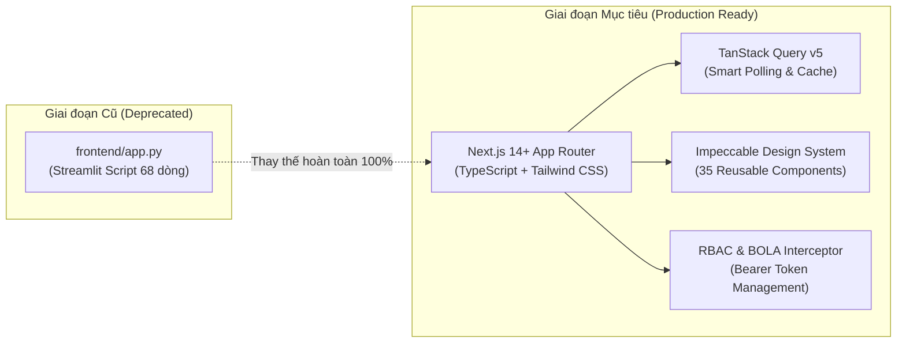

# 12 — PHÂN TÍCH KHOẢNG TRỐNG KỸ THUẬT & GIẢI PHÁP XỬ LÝ (FRONTEND GAP ANALYSIS)
## HỆ THỐNG X-SENTINEL V3 — MALWARE ANALYSIS & THREAT DETECTION PLATFORM

---

### MỤC LỤC
1. [Khảo Sát Hiện Trạng Frontend Nguyên Mẫu (Streamlit Prototype Audit)](#1-khảo-sát-hiện-trạng-frontend-nguyên-mẫu-streamlit-prototype-audit)
2. [Ma Trận Đối Chiếu Hiện Trạng vs Yêu Cầu Production](#2-ma-trận-đối-chiếu-hiện-trạng-vs-yêu-cầu-production)
3. [Danh Mục 16 Khoảng Trống Kỹ Thuật Trọng Yếu & Giải Pháp (Master 16-Gap Catalog)](#3-danh-mục-16-khoảng-trống-kỹ-thuật-trọng-yếu--giải-pháp-master-16-gap-catalog)
   - [GAP-01: Vô Hiệu Hóa Upload Tệp PE Thô (HTTP 501 `XS_FEATURE_DISABLED`)](#gap-01-vô-hiệu-hóa-upload-tệp-pe-thô-http-501-xs_feature_disabled)
   - [GAP-02: Vô Hiệu Hóa Hỏi Đáp Tài Liệu Jev AI (HTTP 501 `XS_FEATURE_DISABLED`)](#gap-02-vô-hiệu-hóa-hỏi-đáp-tài-liệu-jev-ai-http-501-xs_feature_disabled)
   - [GAP-03: Cấm Chuyển Đổi Phiên Bản Mô Hình (Scientific Freeze Invariant)](#gap-03-cấm-chuyển-đổi-phiên-bản-mô-hình-scientific-freeze-invariant)
   - [GAP-04: Kiến Trúc Pure Headless REST API (Security & Framework Boundary)](#gap-04-kiến-trúc-pure-headless-rest-api-security--framework-boundary)
   - [GAP-05: Thiếu Giao Thức Realtime (SSE/WebSocket) & Chiến Lược Smart Polling](#gap-05-thiếu-giao-thức-realtime-ssewebsocket--chiến-lược-smart-polling)
   - [GAP-06: Vận Chuyển Nhận Định Jev AI Nguyên Khối (Non-Streaming Markdown Transport)](#gap-06-vận-chuyển-nhận-định-jev-ai-nguyên-khối-non-streaming-markdown-transport)
   - [GAP-07: Giới Hạn Tải Đồng Thời & Tràn Hàng Đợi (HTTP 429 `XS_*_OVERLOADED`)](#gap-07-giới-hạn-tải-đồng-thời--tràn-hàng-đợi-http-429-xs__overloaded)
   - [GAP-08: Bất Đồng Bộ Hóa Hai Giai Đoạn (Two-Phase Decoupled Transactions)](#gap-08-bất-đồng-bộ-hóa-hai-giai-đoạn-two-phase-decoupled-transactions)
   - [GAP-09: Cách Ly Quyền Sở Hữu BOLA/IDOR Giữa Các Chuyên Viên SOC](#gap-09-cách-ly-quyền-sở-hữu-bolaidor-giữa-các-chuyên-viên-soc)
   - [GAP-10: Hiển Thị Viễn Trắc Phần Cứng Chân Thực từ `psutil` (Authentic Telemetry Protocol)](#gap-10-hiển-thị-viễn-trắc-phần-cứng-chân-thực-từ-psutil-authentic-telemetry-protocol)
   - [GAP-11: Thiếu HTTP Endpoint Cho Đánh Giá Mô Hình Benchmark (`/v1/evaluate` - CLI Only)](#gap-11-thiếu-http-endpoint-cho-đánh-giá-mô-hình-benchmark-v1evaluate---cli-only)
   - [GAP-12: Giới Hạn Nạp Đơn Vector (Single-Vector Ingestion Limit & Client Queue)](#gap-12-giới-hạn-nạp-đơn-vector-single-vector-ingestion-limit--client-queue)
   - [GAP-13: Cơ Chế Chuyển Đổi Token Dev & Giả Lập Vai Trò RBAC (Development Auth Switcher)](#gap-13-cơ-chế-chuyển-đổi-token-dev--giả-lập-vai-trò-rbac-development-auth-switcher)
   - [GAP-14: Bóc Tách Chi Tiết SHAP Từng Thuộc Tính (Per-Feature SHAP Attribution Gap)](#gap-14-bóc-tách-chi-tiết-shap-từng-thuộc-tính-per-feature-shap-attribution-gap)
   - [GAP-15: Lưu Trữ Ghi Chú Giải Trình & Người Xử Lý Cảnh Báo SOC (Alert Notes & Dismissal Persistence Gap)](#gap-15-lưu-trữ-ghi-chú-giải-trình--người-xử-lý-cảnh-báo-soc-alert-notes--dismissal-persistence-gap)
   - [GAP-16: Các Chỉ Số Telemetry Hạ Tầng Chưa Khả Dụng (Extended Host/Uptime/DB Pool Telemetry Gap)](#gap-16-các-chỉ-số-telemetry-hạ-tầng-chưa-khả-dụng-extended-hostuptimedb-pool-telemetry-gap)
4. [Lộ Trình Di Chuyển Công Nghệ (Migration Strategy to Next.js 14+)](#4-lộ-trình-di-chuyển-công-nghệ-migration-strategy-to-nextjs-14)

---

### 1. KHẢO SÁT HIỆN TRẠNG FRONTEND NGUYÊN MẪU (STREAMLIT PROTOTYPE AUDIT)

Hiện tại trong mã nguồn repository, thư mục `frontend/` chỉ tồn tại duy nhất một tệp nguyên mẫu sơ khai: `frontend/app.py` với quy mô vỏn vẹn **68 dòng mã nguồn**.

#### Đánh giá hạn chế chí mạng của `frontend/app.py`:
1. **Thiếu cơ chế Xác thực & Phân quyền:** Toàn bộ ứng dụng không có Header `Authorization: Bearer <token>`, không kiểm tra vai trò người dùng (RBAC), không thể mô phỏng hay kiểm thử các chính sách bảo mật BOLA/IDOR.
2. **Không có Khả năng Điều hướng Nâng cao:** Ứng dụng chạy trên 1 trang cuộn duy nhất của Streamlit, hoàn toàn thiếu cấu trúc 10 trang chuyên biệt theo chuẩn SOC tác chiến.
3. **Trực quan hóa Dữ liệu Sơ sài:** Sử dụng các bảng số liệu mặc định của Pandas/Streamlit, không có biểu đồ giải trình SHAP Waterfall, không có ma trận ATT&CK, không có đồng hồ đo Authentic Telemetry.
4. **Vi phạm Bất biến Giao diện Jev AI:** Không có khung phân tách độc lập và Banner cảnh báo `Advisory Only` màu hổ phách, gây hiểu nhầm giữa nhận định AI định tính và Bằng chứng Canonical có giá trị pháp lý.
5. **Không Xử lý Bất đồng bộ Hai giai đoạn:** Cố gắng chờ toàn bộ quá trình chạy AI hoàn tất mới render giao diện, dẫn đến nguy cơ đóng băng trình duyệt khi hàng đợi LM Studio bị nghẽn.

---

### 2. MA TRẬN ĐỐI CHIẾU HIỆN TRẠNG VS YÊU CẦU PRODUCTION

| Tiêu Chí Đánh Giá | Hiện Trạng (`frontend/app.py`) | Yêu Cầu Production (Next.js 14+) | Mức Độ Nghiêm Trọng |
|:---|:---|:---|:---|
| **Kiến trúc Khung (Framework)** | Streamlit (Python script 68 dòng) | Next.js 14+ App Router, TypeScript, Tailwind | **CRITICAL** (Phải thay thế hoàn toàn) |
| **Bảo mật & RBAC** | Không có xác thực (Chạy nặc danh) | Bearer Token Interceptor, Ma trận 4 vai trò, 12 quyền | **CRITICAL** |
| **Bảo vệ BOLA/IDOR** | Không hỗ trợ | Xử lý chặn truy cập chéo Job ID (HTTP 403) | **HIGH** |
| **Bằng Chứng Canonical** | Hiển thị chuỗi văn bản thô | Hero Card độc tôn, Radial Gauge, Khối SHA-256 Copy 1-Click | **HIGH** |
| **Giải Trình Mô Hình (XAI)** | Không có | Biểu đồ SHAP Waterfall, Top 15 Features, Bảng 2.381 chiều | **HIGH** |
| **Khuyến Nghị Jev AI** | Không có | Khung viền hổ phách, Huy hiệu Advisory Only bắt buộc | **CRITICAL** |
| **Tác Chiến Cảnh Báo SOC** | Không có | Bảng Triage, Stepper 4 bước, Modal đóng cảnh báo | **HIGH** |
| **Viễn Trắc Phần Cứng** | Dữ liệu ngẫu nhiên giả lập | Authentic Telemetry từ `psutil` (CPU, RAM, Process thật) | **MEDIUM** |
| **Quản Lý Bộ Nhớ Đệm** | Không có (Mỗi lần F5 tải lại toàn bộ) | TanStack Query v5, Stale times, Optimistic Updates | **HIGH** |

---

### 3. DANH MỤC 16 KHOẢNG TRỐNG KỸ THUẬT TRỌNG YẾU & GIẢI PHÁP (MASTER 16-GAP CATALOG)

| Gap ID | Tên Khoảng Trống | Phân Loại | Mức Độ | Tóm Tắt Giải Pháp Frontend |
|:---:|---|---|:---:|---|
| **GAP-01** | Vô Hiệu Hóa Upload Tệp PE Thô | Security Invariant / Gating | `CRITICAL` | Tab PE thô hiển thị ổ khóa hổ phách, cảnh báo HTTP 501 `XS_FEATURE_DISABLED`, nút Submit bị disable. |
| **GAP-02** | Vô Hiệu Hóa Hỏi Đáp Tài Liệu Jev AI | Feature Invariant / Gating | `MEDIUM` | Cấm widget chatbot tài liệu; trình bày tài liệu dưới dạng Markdown tĩnh. |
| **GAP-03** | Cấm Chuyển Đổi Phiên Bản Mô Hình | Scientific Freeze Invariant | `HIGH` | Màn hình P08 hiển thị huy hiệu `v3-scientific-frozen` chỉ đọc; vô hiệu hóa mọi nút đổi trọng số/model. |
| **GAP-04** | Kiến Trúc Pure Headless REST API | Architectural Boundary | `CRITICAL` | 100% giao tiếp qua 21 HTTP operations chuẩn JSON; không dùng template Jinja hay HTML render server-side. |
| **GAP-05** | Thiếu Giao Thức Realtime (SSE/WebSocket) | Protocol Gap | `MEDIUM` | Áp dụng Smart Polling 15s in-focus cho alerts qua TanStack Query; phân tích vector chạy đồng bộ tức thì. |
| **GAP-06** | Vận Chuyển Nhận Định Jev AI Nguyên Khối | Transport Mechanism | `MEDIUM` | Hiển thị Skeleton Shimmer khi chờ inference; render Markdown hoàn chỉnh khi nhận chuỗi `response_text`. |
| **GAP-07** | Giới Hạn Tải Đồng Thời & Tràn Hàng Đợi | Capacity Boundary | `HIGH` | Bắt lỗi 429, đọc `Retry-After`, hiển thị Countdown Toast và áp dụng Exponential Backoff. |
| **GAP-08** | Bất Đồng Bộ Hóa Hai Giai Đoạn | Resilience Invariant | `HIGH` | Decoupled UI: Hero verdict và Canonical Evidence render tức thì (<100ms); tab Jev AI tải độc lập. |
| **GAP-09** | Cách Ly Quyền Sở Hữu BOLA/IDOR | Access Control Invariant | `CRITICAL` | Thành phần `BOLAErrorView` bắt 403, hiển thị cảnh báo bảo mật, cung cấp nút quay về lịch sử an toàn. |
| **GAP-10** | Viễn Trắc Phần Cứng Chân Thực `psutil` | Telemetry Protocol | `MEDIUM` | Chuẩn hóa hàm `formatBytes`; hiển thị CPU, RAM, Process từ backend; cấm hoàn toàn mock `Math.random()`. |
| **GAP-11** | Thiếu HTTP Endpoint Cho Benchmark | Functional Gap (CLI Only) | `HIGH` | Đánh dấu P09 là `[STATUS: DESIGN_ONLY / BACKEND_GAP]`; nạp dữ liệu snapshot từ `evaluation_mock_data.json`. |
| **GAP-12** | Giới Hạn Nạp Đơn Vector 2.381 Chiều | Throughput Boundary | `MEDIUM` | Hàng đợi Client-side `analysisService.submitBatch()` tự động tuần tự hóa và hiển thị thanh tiến trình. |
| **GAP-13** | Cơ Chế Chuyển Đổi Token Dev & RBAC | Development Auth Scope | `LOW` | Trang `/auth/switch` và Floating Dev Switcher cho phép hoán đổi 1-click giữa các test token. |
| **GAP-14** | Bóc Tách Chi Tiết SHAP Từng Thuộc Tính | Functional Gap (XAI API) | `HIGH` | Đánh dấu Waterfall/Top 15 trên P03 là `DESIGN_ONLY` / Mock Data; hiển thị 3-View và M1-M5 authentic. |
| **GAP-15** | Lưu Trữ Ghi Chú & Người Xử Lý Cảnh Báo | Data Persistence Gap | `MEDIUM` | Lưu ghi chú tại Client In-Memory State (cấm unencrypted localStorage); payload PATCH chỉ gửi `{"status": string}`. |
| **GAP-16** | Các Chỉ Số Telemetry Hạ Tầng Chưa Khả Dụng | Telemetry Scope Gap | `LOW` | Hiển thị Hostname, OS, Uptime, DB Pool chi tiết dưới dạng tĩnh `DESIGN_ONLY`; dùng số liệu `psutil` thật. |

---

#### GAP-01: VÔ HIỆU HÓA UPLOAD TỆP PE THÔ (HTTP 501 `XS_FEATURE_DISABLED`)
- **Hành vi Backend:** Khi gửi request tới `POST /v1/analyze/file`, Backend lập tức trả về mã trạng thái HTTP 501 kèm mã lỗi `XS_FEATURE_DISABLED`. Đây là tính năng được chủ động khóa an toàn (Fail-closed Design) nhằm ngăn ngừa rủi ro phát tán mã độc nhị phân trực tiếp trong môi trường mạng nội bộ khi chưa hoàn tất kiểm định trích xuất tương đương thư viện LIEF.
- **Rủi ro Giao diện:** Nếu Frontend hiển thị form kéo thả file mà không cảnh báo trước, người dùng sẽ liên tục thử tải file lên và gặp lỗi 501, dẫn tới ức chế và hiểu lầm hệ thống bị lỗi.
- **Giải pháp Frontend:**
  1. Tab "File Upload" trên trang `/analyze` hiển thị huy hiệu `[Vô Hiệu Hóa An Toàn]` kèm ổ khóa màu hổ phách.
  2. Khi nhấp vào tab này, hiển thị ngay Banner giải thích:
     `Chức năng nộp tệp nhị phân thô tạm thời vô hiệu hóa theo tiêu chuẩn an ninh cách ly mã độc (TC-03). Vui lòng sử dụng phương thức nộp Feature Vector 2.381 chiều EMBER.`
  3. Nút nộp file bị khóa (`disabled`), không gửi bất kỳ request nào lên máy chủ.

---

#### GAP-02: VÔ HIỆU HÓA HỎI ĐÁP TÀI LIỆU JEV AI (HTTP 501 `XS_FEATURE_DISABLED`)
- **Hành vi Backend:** Endpoint `POST /v1/ai/docs/ask` bị khóa với mã lỗi 501 `XS_FEATURE_DISABLED` do phân hệ RAG tìm kiếm tài liệu chưa được kết nối kho lưu trữ tài liệu Vector DB.
- **Giải pháp Frontend:**
  1. Tuyệt đối không xây dựng Widget Chatbox "Hỏi Đáp Tài Liệu" trên thanh Sidebar hoặc Header.
  2. Toàn bộ tài liệu hướng dẫn sử dụng và cẩm nang kỹ thuật được hiển thị dưới dạng trang tĩnh Markdown thay vì giao diện Chatbot AI giả lập.

---

#### GAP-03: CẤM CHUYỂN ĐỔI PHIÊN BẢN MÔ HÌNH (SCIENTIFIC FREEZE INVARIANT)
- **Hành vi Backend:** Backend X-SENTINEL V3 không cung cấp endpoint cho phép hot-swap hoặc thay đổi trọng số mô hình LightGBM trong thời gian chạy nhằm bảo vệ tính khả lập lại và toàn vẹn pháp chứng của các bài thực nghiệm.
- **Giải pháp Frontend:**
  1. Trên trang P08 (`/system/status`), phần hiển thị phiên bản mô hình được cố định bằng huy hiệu `v3-scientific-frozen` chỉ đọc.
  2. Không thiết kế nút bấm chuyển đổi phiên bản hay tải mô hình tùy chỉnh trong giao diện người dùng production.

---

#### GAP-04: KIẾN TRÚC PURE HEADLESS REST API (SECURITY & FRAMEWORK BOUNDARY)
- **Hành vi Backend:** Toàn bộ hệ thống Backend vận hành theo kiến trúc Pure Headless REST API chuẩn hóa JSON (`{"success": true/false, "data": ..., "error": ...}`). Nghiêm cấm hoàn toàn các tệp Jinja template (`*.html`), static CSS/JS dư thừa, hoặc thư mục giả lập `frontend-preview/`.
- **Giải pháp Frontend:**
  1. Frontend đóng vai trò thuần túy là một ứng dụng khách (API Consumer) độc lập xây dựng trên Next.js 14+ / React 18+.
  2. Mọi luồng dữ liệu đều đi qua các client được định kiểu chặt chẽ với Zod validation, không phụ thuộc vào bất kỳ mã HTML nào do máy chủ sinh ra.

---

#### GAP-05: THIẾU GIAO THỨC REALTIME (SSE/WEBSOCKET) & CHIẾN LƯỢC SMART POLLING
- **Hành vi Backend:** Backend chưa hỗ trợ giao thức đẩy thời gian thực (Server-Sent Events hoặc WebSocket). Trạng thái phân tích của Job và danh sách cảnh báo SOC được cập nhật bất đồng bộ trong CSDL SQL Server.
- **Giải pháp Frontend:**
  1. Phân tích vector qua `POST /v1/analyze/vector` chạy đồng bộ hoàn toàn và trả về kết quả ngay lập tức, do đó trang `/analyze` chuyển thẳng sang `/analysis/{id}` mà không cần polling trạng thái chờ phân tích.
  2. Đối với Trung tâm Cảnh báo (`/alerts`): Thiết lập chu kỳ cập nhật nền tự động mỗi 15 giây/lần (`refetchInterval: 15000`) bằng TanStack Query khi tab trình duyệt đang focus; tạm dừng khi tab ở background.
  3. Cung cấp nút bấm "Làm mới ngay (Refresh Now)" trên bảng cảnh báo để người dùng chủ động tải dữ liệu mới.

---

#### GAP-06: VẬN CHUYỂN NHẬN ĐỊNH JEV AI NGUYÊN KHỐI (NON-STREAMING MARKDOWN TRANSPORT)
- **Hành vi Backend:** Endpoint `POST /v1/ai/explain` trả về phản hồi nguyên khối (monolithic response) sau 2–5 giây suy luận từ LM Studio; trường `response_text` chứa toàn bộ văn bản Markdown thay vì các token stream.
- **Giải pháp Frontend:**
  1. Hiển thị Skeleton Shimmer trong thời gian chờ suy luận.
  2. Khi nhận phản hồi `JevAIRunResponse`, render văn bản Markdown qua `react-markdown` kết hợp hiệu ứng typing/fade-in mượt mà, giúp trải nghiệm người dùng tự nhiên và không bị giật lag.

---

#### GAP-07: GIỚI HẠN TẢI ĐỒNG THỜI & TRÀN HÀNG ĐỢI (HTTP 429 `XS_*_OVERLOADED`)
- **Hành vi Backend:**
  - Bộ suy luận Detector Ensemble giới hạn tối đa 50 yêu cầu đồng thời. Vượt quá ngưỡng trả về HTTP 429 `XS_DETECTOR_OVERLOADED`.
  - Phân hệ Jev AI (LM Studio) giới hạn tối đa 4 yêu cầu đồng thời và hàng đợi 16 tác vụ. Vượt quá ngưỡng trả về HTTP 429 `XS_AI_OVERLOADED`.
- **Giải pháp Frontend:**
  1. Response Interceptor nhận diện mã lỗi 429 và bóc tách thuộc tính `Retry-After` (nếu có).
  2. Hiển thị thông báo Toast dạng Đếm ngược tự động (Countdown Toast):
     `Hệ thống đang xử lý tối đa công suất. Tự động thử lại sau 5... 4... 3... giây.`
  3. Tự động kích hoạt cơ chế Exponential Backoff cho các yêu cầu nền.

---

#### GAP-08: BẤT ĐỒNG BỘ HÓA HAI GIAI ĐOẠN (TWO-PHASE DECOUPLED TRANSACTIONS)
- **Hành vi Backend:**
  - **Giai đoạn 1:** Phân tích mã độc hoàn tất -> Kết quả Canonical được ghi vào CSDL và Commit Transaction ngay lập tức.
  - **Giai đoạn 2:** Gọi LLM LM Studio để sinh nhận định Jev AI. Nếu LM Studio bị chậm hoặc lỗi, kết quả Canonical tại Giai đoạn 1 vẫn hoàn toàn an toàn và nguyên vẹn.
- **Giải pháp Frontend:**
  1. **Hiển thị Độc lập (Decoupled Rendering):** Khi mở trang `/analysis/{id}`, phần Hero Phán Quyết và Bảng 5 Module Canonical Evidence được hiển thị ngay lập tức ($Latency < 100\text{ms}$).
  2. Tab "Khuyến Nghị Jev AI" hiển thị trạng thái Skeleton Shimmer riêng biệt cho đến khi API `/v1/ai/explain` trả về kết quả. Tuyệt đối không để độ trễ của Jev AI làm chậm màn hình kết quả Canonical.

---

#### GAP-09: CÁCH LY QUYỀN SỞ HỮU BOLA/IDOR GIỮA CÁC CHUYÊN VIÊN SOC
- **Hành vi Backend:** Hàm `assert_job_ownership(job, current_user)` kiểm tra quyền sở hữu. Nếu Chuyên viên A (`token-analyst-2`) cố tình truy cập Job của Chuyên viên B (`token-analyst`), Backend trả về mã lỗi HTTP 403 `XS_FORBIDDEN`. (Chỉ vai trò `admin` mới được xem toàn bộ).
- **Giải pháp Frontend:**
  1. Xây dựng thành phần `BOLAErrorView` chuẩn mực: Khi gặp lỗi 403, không làm sập ứng dụng (Crash Page).
  2. Hiển thị thông báo bảo mật chuyên nghiệp:
     `Quyền Truy Cập Bị Giới Hạn: Hồ sơ phân tích này thuộc quyền quản lý của chuyên viên khác. Hành vi truy cập bất thường đã được lưu vết kiểm toán an ninh.`
  3. Cung cấp nút điều hướng an toàn: `[ Quay lại Nhật ký phân tích cá nhân ]`.

---

#### GAP-10: HIỂN THỊ VIỄN TRẮC PHẦN CỨNG CHÂN THỰC TỪ `psutil` (AUTHENTIC TELEMETRY PROTOCOL)
- **Hành vi Backend:** Endpoint `GET /v1/system/telemetry` đọc trực tiếp thông số vật lý của máy chủ qua thư viện `psutil` (CPU %, số lõi, RAM thực tế tính theo Bytes, thông số tiến trình PID/RSS/VMS/threads; loại bỏ hoàn toàn các chỉ số disk giả lập).
- **Giải pháp Frontend:**
  1. Triển khai hàm chuyển đổi đơn vị chuẩn hóa (`formatBytes` chuyển đổi Bytes sang GB/TB chính xác).
  2. Tuyệt đối không sử dụng thư viện tạo số ngẫu nhiên (`Math.random()`) để vẽ biểu đồ giả lập khi dữ liệu đang tải, bảo toàn tính liêm chính dữ liệu $100\%$.

---

#### GAP-11: THIẾU HTTP ENDPOINT CHO ĐÁNH GIÁ MÔ HÌNH BENCHMARK (`/v1/evaluate` - CLI ONLY)
- **Hành vi Backend:** Backend hiện tại **CHƯA CÓ** các HTTP endpoint `/v1/evaluate`. Động cơ đánh giá benchmark của X-SENTINEL hiện vận hành qua CLI runner độc lập ghi trực tiếp vào bảng `experiment_runs` và thư mục `artifacts/evaluation/`.
- **Giải pháp Frontend:**
  1. Trang P09 (`/evaluation`) được phát triển theo chế độ **[STATUS: DESIGN_ONLY / BACKEND_GAP]**.
  2. Hiển thị Banner cảnh báo nghiệp vụ: *"Dữ liệu Benchmark hiện tại được kết xuất từ snapshot thực nghiệm ngoại tuyến (run_evaluation.py). Kích hoạt trực tiếp qua HTTP đang chờ bổ sung endpoint từ backend."*
  3. Nạp dữ liệu tĩnh từ `evaluation_mock_data.json` trích xuất trực tiếp từ kết quả CLI runner.

---

#### GAP-12: GIỚI HẠN NẠP ĐƠN VECTOR 2.381 CHIỀU (SINGLE-VECTOR INGESTION LIMIT & CLIENT QUEUE)
- **Hành vi Backend:** Endpoint `POST /v1/analyze/vector` tiếp nhận duy nhất một vector 2.381 chiều cho mỗi yêu cầu HTTP (chưa hỗ trợ batch upload array-of-vectors).
- **Giải pháp Frontend:**
  1. Khi người dùng nộp tệp chứa danh sách nhiều vector, tầng service phía Client (`analysisService.submitBatch()`) tự động phân tách và gửi từng vector theo hàng đợi tuần tự.
  2. Hiển thị thanh tiến trình xử lý mẻ (Batch Progress Bar: `Đang phân tích 12/50 mẫu PE...`) kèm cơ chế hủy hàng đợi nếu người dùng yêu cầu dừng.

---

#### GAP-13: CƠ CHẾ CHUYỂN ĐỔI TOKEN DEV & GIẢ LẬP VAI TRÒ RBAC (DEVELOPMENT AUTH SWITCHER)
- **Hành vi Backend:** Backend sử dụng cơ chế xác thực Bearer token với tập token định sẵn phục vụ môi trường kiểm thử:
  - `token-admin` (Quản trị viên tối cao)
  - `token-analyst` (Chuyên viên SOC chính)
  - `token-analyst-2` (Chuyên viên phụ - kiểm thử BOLA)
  - `token-operator` (Vận hành viên - nộp vector, xem lịch sử của mình, xem alert)
  - `token-evaluator` (Đánh giá mô hình AI - chỉ đọc kết quả, không nộp mẫu)
  - `token-inactive` (Tài khoản bị khóa - HTTP 403)
- **Giải pháp Frontend:**
  1. Xây dựng trang P10 (`/auth/switch`) và một Floating Dev Switcher Widget ở góc dưới màn hình trong môi trường Development (`NODE_ENV === 'development'`).
  2. Cho phép kỹ sư kiểm thử chuyển đổi danh tính 1-Click, tự động lưu token mới vào `localStorage` và làm mới toàn bộ bộ nhớ đệm TanStack Query.

---

#### GAP-14: BÓC TÁCH CHI TIẾT SHAP TỪNG THUỘC TÍNH (PER-FEATURE SHAP ATTRIBUTION GAP)
- **Hành vi Backend:** Endpoint `GET /v1/analysis/{id}` trả về `view_contributions` (3 Semantic Views) và chẩn đoán `scores` (5 detector M1–M5), nhưng hiện tại chưa có HTTP endpoint cung cấp mảng 2.381 giá trị SHAP cá nhân (tên đặc trưng, giá trị thô, giá trị đóng góp Shapley cục bộ).
- **Rủi ro Giao diện:** Thiết kế trang P03 (`/analysis/{id}/explainability`) có Biểu đồ thác nước (Waterfall Plot Top 15) và Bảng tra cứu 2.381 thuộc tính. Nếu cố gọi API không tồn tại sẽ gây lỗi kết nối hoặc render rỗng.
- **Giải pháp Frontend:**
  1. Đánh dấu khối Top 15 SHAP Waterfall và Bảng tra cứu thuộc tính trên trang P03 là **[STATUS: DESIGN_ONLY / BACKEND_GAP]**.
  2. Hiển thị badge chú thích rõ ràng: `[MOCK / DESIGN_ONLY — Đang chờ API XAI bóc tách đặc trưng chi tiết]`.
  3. Sử dụng dữ liệu mẫu minh họa (Mock Data) chuẩn hóa để giữ nguyên layout và khả năng tương tác của biểu đồ mà không làm sai lệch tính toàn vẹn của kết quả Canonical.

---

#### GAP-15: LƯU TRỮ GHI CHÚ GIẢI TRÌNH & NGƯỜI XỬ LÝ CẢNH BÁO SOC (ALERT NOTES & DISMISSAL PERSISTENCE GAP)
- **Hành vi Backend:**
  - Endpoint `PATCH /v1/alerts/{id}` nhận payload nghiêm ngặt theo schema `AlertStatusUpdateRequest` với duy nhất 1 trường: `{"status": string}` (hợp lệ: `acknowledged`, `resolved`, `dismissed`).
  - Backend hiện tại **không có cột** lưu trữ `assignee_id` (người xử lý), `investigation_notes` (ghi chú điều tra), hay `dismissal_reason` (lý do đóng cảnh báo) trong bảng `alerts`.
- **Rủi ro Giao diện:** Nếu Frontend cố gửi thêm các trường `assignee_id` hoặc `notes` trong body của PATCH, FastAPI/Pydantic sẽ bỏ qua hoặc có thể gây lỗi xác thực nếu cấu hình strict.
- **Giải pháp Frontend:**
  1. Quy tắc UX yêu cầu nhập lý do giải trình $\ge 20$ ký tự khi Dismiss là kiểm thực thuần túy phía Client-side (`GAP-15`).
  2. Khi gửi yêu cầu tới Backend qua `PATCH /v1/alerts/{id}`, chỉ gửi duy nhất payload `{"status": "dismissed"}` (hoặc `acknowledged`, `resolved`).
  3. Ghi chú điều tra và người xử lý được lưu trữ tại Client In-Memory State (React/Zustand) trong phiên làm việc của chuyên viên SOC. BẤT BIẾN AN NINH: CẤM TUYỆT ĐỐI lưu trữ ghi chú điều tra SOC hoặc lý do đóng cảnh báo vào unencrypted localStorage trên trình duyệt để loại trừ rủi ro rò rỉ dữ liệu điều tra trên thiết bị dùng chung.

---

#### GAP-16: CÁC CHỈ SỐ TELEMETRY HẠ TẦNG CHƯA KHẢ DỤNG (EXTENDED HOST/UPTIME/DB POOL TELEMETRY GAP)
- **Hành vi Backend:**
  - Endpoint `GET /v1/system/telemetry` chỉ trả về thông số đo đạc thực tế từ thư viện `psutil`: `status`, `cpu` (`utilization_percent`, `logical_cores`, `physical_cores`), `memory` (`total_bytes`, `available_bytes`, `used_bytes`, `used_percent`), và `process` (`pid`, `rss_bytes`, `vms_bytes`, `thread_count`).
  - Backend **không cung cấp** các trường: Tên máy chủ (Hostname), Tên hệ điều hành (OS String), Thời gian hoạt động (Uptime), Chi tiết kết nối Database Connection Pool (ví dụ: `18/50 active`), Số lượng slot Concurrency (`concurrency_slots: 50`), và Độ sâu hàng đợi Jev AI (`queue: 0/16`).
- **Rủi ro Giao diện:** Thiết kế bảng điều khiển P08 nếu bịa đặt các số liệu này động sẽ vi phạm nguyên tắc Bất Biến Giám Sát Phần Cứng Thực Tế (Authentic Telemetry).
- **Giải pháp Frontend:**
  1. Hiển thị 100% dữ liệu thật từ `GET /v1/system/telemetry` cho các widget CPU, RAM, Process.
  2. Các thành phần Hostname, OS name, Uptime, Connection Pool count, Concurrency slots, Jev queue depth được gắn nhãn tĩnh `[DESIGN_ONLY / Chờ Telemetry v2]` hoặc placeholder tĩnh, tuyệt đối không dùng hàm ngẫu nhiên (`Math.random()`) giả lập dữ liệu viễn trắc.

---

### 4. LỘ TRÌNH DI CHUYỂN CÔNG NGHỆ (MIGRATION STRATEGY TO NEXT.JS 14+)

1. **Bước 1: Cách ly nguyên mẫu cũ:** Giữ lại `frontend/app.py` làm tài liệu tham khảo lịch sử, tạo thư mục mã nguồn chính thức tại `frontend-next/` (hoặc chuyển đổi thư mục `frontend/` sang cấu trúc Node.js).
2. **Bước 2: Dựng nền tảng Type Contracts:** Sao chép toàn bộ các định nghĩa kiểu dữ liệu từ tài liệu `11-DATA-CONTRACTS.md` vào `src/types/`.
3. **Bước 3: Xây dựng HTTP Client & Interceptors:** Triển khai theo đặc tả tại tài liệu `10-FRONTEND-API-INTEGRATION.md`.
4. **Bước 4: Phát triển 35 Components:** Dựng từ nguyên tử (Atoms) tới khối nghiệp vụ phức tạp theo tài liệu `09-COMPONENT-INVENTORY.md`.
5. **Bước 5: Hoàn thiện 10 Màn hình:** Lắp ráp giao diện theo đặc tả tại tài liệu `07` và `08`.
