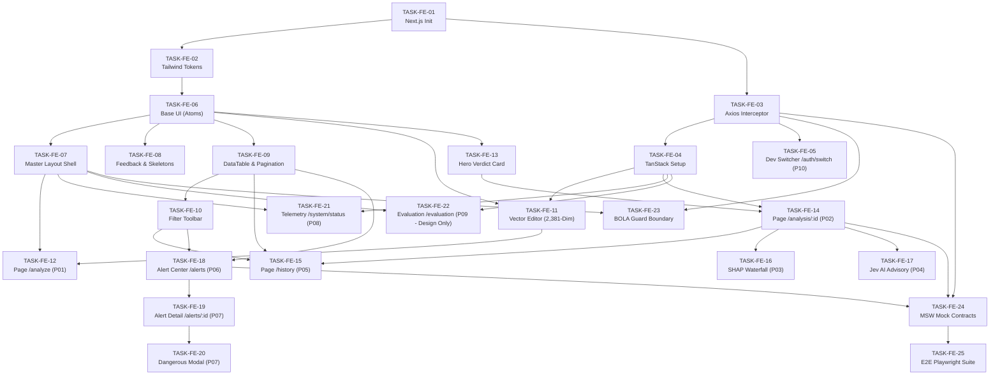

# 13 — LỘ TRÌNH TRIỂN KHAI FRONTEND CHI TIẾT (FRONTEND IMPLEMENTATION ROADMAP)
## HỆ THỐNG X-SENTINEL V3 — MALWARE ANALYSIS & THREAT DETECTION PLATFORM

---

### MỤC LỤC
1. [Tổng Quan 5 Giai Đoạn Triển Khai (Phase Breakdown)](#1-tổng-quan-5-giai-đoạn-triển-khai-phase-breakdown)
2. [Sơ Đồ Phụ Thuộc Kỹ Thuật (Task Dependency DAG)](#2-sơ-đồ-phụ-thuộc-kỹ-thuật-task-dependency-dag)
3. [Đặc Tả Chi Tiết 25 Tác Vụ Kỹ Thuật (TASK-FE-01 đến TASK-FE-25)](#3-đặc-tả-chi-tiết-25-tác-vụ-kỹ-thuật-task-fe-01-đến-task-fe-25)
   - [Giai Đoạn 1: Hạ Tầng Cốt Lõi & Hệ Thống Thiết Kế (Tasks 01 - 05)](#giai-đoạn-1-hạ-tầng-cốt-lõi--hệ-thống-thiết-kế-tasks-01---05)
   - [Giai Đoạn 2: Thành Phần Cơ Sở & Master Layout Shell (Tasks 06 - 10)](#giai-đoạn-2-thành-phần-cơ-sở--master-layout-shell-tasks-06---10)
   - [Giai Đoạn 3: Trải Nghiệm Phân Tích Mã Độc & Canonical Evidence (Tasks 11 - 15)](#giai-đoạn-3-trải-nghiệm-phân-tích-mã-độc--canonical-evidence-tasks-11---15)
   - [Giai Đoạn 4: Giải Trình XAI, Cố Vấn Jev AI & Tác Chiến SOC (Tasks 16 - 20)](#giai-đoạn-4-giải-trình-xai-cố-vấn-jev-ai--tác-chiến-soc-tasks-16---20)
   - [Giai Đoạn 5: Viễn Trắc Hạ Tầng, Benchmark & Kiểm Thử E2E (Tasks 21 - 25)](#giai-đoạn-5-viễn-trắc-hạ-tầng-benchmark--kiểm-thử-e2e-tasks-21---25)
4. [Kế Hoạch Bàn Giao & Tiêu Chuẩn Nghiệm Thu (Definition of Done)](#4-kế-hoạch-bàn-giao--tiêu-chuẩn-nghiệm-thu-definition-of-done)

---

### 1. TỔNG QUAN 5 GIAI ĐOẠN TRIỂN KHAI (PHASE BREAKDOWN)

Lộ trình phát triển Frontend cho X-SENTINEL V3 được chia thành 5 giai đoạn liên hoàn, sắp xếp theo thứ tự phụ thuộc kỹ thuật nghiêm ngặt (Strict Technical Precedence), đảm bảo mỗi giai đoạn đều có thể kiểm thử độc lập trước khi chuyển tiếp:

```
[ Phase 1: Infrastructure & Tokens ] (Tasks 01 - 05)
                │
                ▼
[ Phase 2: Base UI & Master Shell ]  (Tasks 06 - 10)
                │
                ▼
[ Phase 3: Core Analysis & Canonical ] (Tasks 11 - 15)
                │
                ▼
[ Phase 4: XAI, Jev AI & SOC Triage ] (Tasks 16 - 20)
                │
                ▼
[ Phase 5: Telemetry, Bench & E2E ]   (Tasks 21 - 25)
```

---

### 2. SƠ ĐỒ PHỤ THUỘC KỸ THUẬT (TASK DEPENDENCY DAG)



---

### 3. ĐẶC TẢ CHI TIẾT 25 TÁC VỤ KỸ THUẬT (TASK-FE-01 ĐẾN TASK-FE-25)

#### GIAI ĐOẠN 1: HẠ TẦNG CỐT LÕI & HỆ THỐNG THIẾT KẾ (TASKS 01 - 05)

##### TASK-FE-01: Khởi Tạo Dự Án Next.js 14+ App Router & Cấu Hình TypeScript
- **Mục tiêu:** Thiết lập khung dự án Next.js 14 (App Router) với TypeScript ở chế độ Strict Type Check.
- **Tệp nguồn chính:** `package.json`, `tsconfig.json`, `next.config.js`.
- **Tiêu chuẩn hoàn thành:** Lệnh `npm run build` thực thi thành công không có bất kỳ lỗi linter hoặc type check nào.

##### TASK-FE-02: Cấu Hình Tailwind CSS & Hệ Thống Design Tokens Impeccable
- **Mục tiêu:** Ánh xạ toàn bộ bảng mã màu (Calibrated Palette), Spacing Tokens (4-8-12-16-24-32px) và quy tắc bo góc lồng nhau vào `tailwind.config.js`.
- **Tệp nguồn chính:** `tailwind.config.js`, `src/app/globals.css`.
- **Tiêu chuẩn hoàn thành:** Tuyệt đối không chứa Pure Black (`#000000`) hay Pure White (`#ffffff`), kiểm tra tương phản WCAG AA đạt $\ge 4.5:1$.

##### TASK-FE-03: Xây Dựng Axios Client, Interceptor & Chuẩn Hóa Lỗi `XS_*`
- **Mục tiêu:** Thiết lập lớp khách HTTP tự động chèn `X-Request-ID`, Bearer Token và bóc tách lỗi `detail: { code, message }`.
- **Tệp nguồn chính:** `src/lib/api/client.ts`.
- **Tiêu chuẩn hoàn thành:** Xử lý triệt để mã 401, 403 (BOLA), 429 (Overloaded), 501 (Disabled), 503 (Unavailable).

##### TASK-FE-04: Cấu Hình TanStack Query v5 & Factory Khóa Truy Vấn (`queryKeys`)
- **Mục tiêu:** Thiết lập QueryClientProvider, stale times (Canonical: Infinity, Telemetry: 5s, Alerts: 15s) và khóa truy vấn phân cấp.
- **Tệp nguồn chính:** `src/providers/query-provider.tsx`, `src/lib/api/query-keys.ts`.
- **Tiêu chuẩn hoàn thành:** Khóa truy vấn quản lý tập trung, không hardcode chuỗi string trong hook.

##### TASK-FE-05: Xây Dựng Dev Role Switcher & Quản Lý Phiên Làm Việc (`/auth/switch` - P10)
- **Mục tiêu:** Cho phép kỹ sư chuyển đổi nhanh giữa 5 token (`token-admin`, `token-analyst`, `token-analyst-2`, `token-operator`, `token-evaluator`).
- **Tệp nguồn chính:** `src/components/navigation/dev-role-switcher.tsx`, `src/app/auth/switch/page.tsx`.
- **Tiêu chuẩn hoàn thành:** Chuyển vai trò 1-Click, làm mới ngay lập tức trạng thái quyền hạn trên toàn bộ ứng dụng.

---

#### GIAI ĐOẠN 2: THÀNH PHẦN CƠ SỞ & MASTER LAYOUT SHELL (TASKS 06 - 10)

##### TASK-FE-06: Phát Triển Bộ Thành Phần Base UI (Atoms: C01 - C08)
- **Mục tiêu:** Xây dựng `Button` (tỷ lệ đệm 2:1), `Input` (3 cấp độ), `Select`, `Checkbox`, `RadioGroup`, `Badge`, `Tooltip`, `Dialog`.
- **Tệp nguồn chính:** `src/components/ui/*.tsx`.
- **Tiêu chuẩn hoàn thành:** Hỗ trợ đầy đủ phím `Tab`, `Enter`, `Escape`, đạt chuẩn Accessibility a11y.

##### TASK-FE-07: Xây Dựng Master Layout Shell (Sidebar, Header, Breadcrumbs)
- **Mục tiêu:** Cấu trúc layout chia tách (Persistent Sidebar 260px, Topbar 64px, Content Workspace 1440px max).
- **Tệp nguồn chính:** `src/components/navigation/sidebar-nav.tsx`, `src/components/navigation/header.tsx`, `src/app/layout.tsx`.
- **Tiêu chuẩn hoàn thành:** Ẩn các mục menu không đủ quyền truy cập theo vai trò người dùng (Role-based Menu Visibility).

##### TASK-FE-08: Xây Dựng Bộ Phản Hồi Vi Tương Tác & Skeleton Shimmer
- **Mục tiêu:** Tạo `SkeletonCard`, `SkeletonTable`, `InlineFieldError`, `ToastNotification` và `EmptyStatePlaceholder`.
- **Tệp nguồn chính:** `src/components/feedback/*.tsx`.
- **Tiêu chuẩn hoàn thành:** Không dùng spinner tròn trung tâm, bảo toàn chiều cao chống giật layout (CLS = 0.00).

##### TASK-FE-09: Xây Dựng Bảng Dữ Liệu Đa Năng (`DataTable`) & Phân Trang
- **Mục tiêu:** Component `DataTable` hỗ trợ sắp xếp cột, đổi độ rộng và `PaginationControls` hiển thị tổng số kết quả.
- **Tệp nguồn chính:** `src/components/tables/data-table.tsx`, `src/components/tables/pagination-controls.tsx`.
- **Tiêu chuẩn hoàn thành:** Bố cục phẳng, khoảng cách dòng thoáng đãng, hiệu ứng hover mượt mà.

##### TASK-FE-10: Xây Dựng Thanh Công Cụ Lọc Đa Tiêu Chí (`FilterToolbar`)
- **Mục tiêu:** Hỗ trợ lọc theo phán quyết, trạng thái job, khoảng thời gian và ô tìm kiếm toàn văn.
- **Tệp nguồn chính:** `src/components/tables/filter-toolbar.tsx`.
- **Tiêu chuẩn hoàn thành:** Đồng bộ trạng thái lọc lên URL Search Params để hỗ trợ chia sẻ link (Deep Linking).

---

#### GIAI ĐOẠN 3: TRẢI NGHIỆM PHÂN TÍCH MÃ ĐỘC & CANONICAL EVIDENCE (TASKS 11 - 15)

##### TASK-FE-11: Trình Soạn Thảo Vector 2.381 Chiều & Bộ Nạp Dữ Liệu Mẫu
- **Mục tiêu:** Xây dựng `FeatureVectorEditor` kiểm tra realtime 2.381 phần tử số thực và `SamplePresetLoader` nạp mẫu benchmark 1-click.
- **Tệp nguồn chính:** `src/components/domain/feature-vector-editor.tsx`, `src/components/domain/sample-preset-loader.tsx`.
- **Tiêu chuẩn hoàn thành:** Báo lỗi tức thì nếu số lượng phần tử khác 2.381 hoặc chứa phần tử không phải số thực hữu hạn (finite float - FIX-04).

##### TASK-FE-12: Xây Dựng Trang Nộp Mẫu Phân Tích (`/analyze` - P01)
- **Mục tiêu:** Hoàn thiện giao diện P01 với Banner cảnh báo khóa file nhị phân (HTTP 501 `XS_FEATURE_DISABLED`) và nút chạy phân tích vector 2.381 chiều.
- **Tệp nguồn chính:** `src/app/analyze/page.tsx`.
- **Tiêu chuẩn hoàn thành:** Gửi thành công vector tới `POST /v1/analyze/vector`, tự động điều hướng sang `/analysis/{id}`.

##### TASK-FE-13: Xây Dựng Thẻ Phán Quyết Hero & Đồng Hồ Đo Độ Tin Cậy
- **Mục tiêu:** Hoàn thiện `HeroVerdictCard` (Tiêu điểm thị giác độc tôn), `RadialConfidenceGauge` và `EvidenceHashBlock` (SHA-256).
- **Tệp nguồn chính:** `src/components/metrics/hero-verdict-card.tsx`, `src/components/metrics/evidence-hash-block.tsx`.
- **Tiêu chuẩn hoàn thành:** Hiển thị nổi bật các màu phán quyết Canonical (PASS, ALERT, QUARANTINE), nút copy SHA-256 hoạt động chuẩn xác.

##### TASK-FE-14: Xây Dựng Trang Chi Tiết Bằng Chứng Canonical (`/analysis/{id}` - P02)
- **Mục tiêu:** Màn hình P02 hiển thị Bảng phân rã 5 module M1-M5, thông tin sở hữu BOLA và truy vấn kết quả đồng bộ.
- **Tệp nguồn chính:** `src/app/analysis/[id]/page.tsx`, `src/hooks/use-analysis-detail.ts`.
- **Tiêu chuẩn hoàn thành:** Hiển thị tức thì kết quả phân tích đồng bộ, nạp đầy đủ điểm chẩn đoán 5 module M1-M5 (TADR, STRIP, View Conc., View Disagr., Semantic Plausibility).

##### TASK-FE-15: Xây Dựng Trang Nhật Ký Lịch Sử Phân Tích (`/history` - P05)
- **Mục tiêu:** Màn hình P05 tích hợp bảng dữ liệu phân trang, lọc nâng cao và tính năng xuất dữ liệu báo cáo JSON.
- **Tệp nguồn chính:** `src/app/history/page.tsx`.
- **Tiêu chuẩn hoàn thành:** Tải dữ liệu phân trang mượt mà từ `GET /v1/analysis`, lọc theo người dùng sở hữu.

---

#### GIAI ĐOẠN 4: GIẢI TRÌNH XAI, CỐ VẤN JEV AI & TÁC CHIẾN SOC (TASKS 16 - 20)

##### TASK-FE-16: Xây Dựng Biểu Đồ SHAP Waterfall & Bảng 2.381 Chiều (`/explainability` - P03)
- **Mục tiêu:** Hoàn thiện trực quan hóa XAI với biểu đồ thanh ngang Top 15 đặc trưng tác động và bảng tra cứu chi tiết 2.381 thuộc tính.
- **Tệp nguồn chính:** `src/app/analysis/[id]/explainability/page.tsx`, `src/components/visualizations/shap-waterfall.tsx`.
- **Tiêu chuẩn hoàn thành:** Hiển thị rõ ràng màu đỏ cam cho SHAP đẩy nguy cơ và màu xanh ngọc cho SHAP kéo về an toàn.

##### TASK-FE-17: Xây Dựng Khung Khuyến Nghị Cố Vấn Jev AI (`/ai-advisory` - P04)
- **Mục tiêu:** Màn hình P04 với Banner cảnh báo `Advisory Only` bắt buộc, văn bản nhận định Markdown và ma trận kỹ thuật MITRE ATT&CK.
- **Tệp nguồn chính:** `src/app/analysis/[id]/ai-advisory/page.tsx`, `src/components/domain/jev-advisory-container.tsx`.
- **Tiêu chuẩn hoàn thành:** Tách biệt hoàn toàn về mặt thị giác với kết quả Canonical, hiển thị đúng cấu trúc playbook ứng phó sự cố.

##### TASK-FE-18: Xây Dựng Bảng Điều Khiển Trung Tâm Cảnh Báo SOC (`/alerts` - P06)
- **Mục tiêu:** Màn hình P06 với 4 thẻ chỉ số KPI, các tab trạng thái quy trình và cơ chế cập nhật cảnh báo nền mỗi 15 giây.
- **Tệp nguồn chính:** `src/app/alerts/page.tsx`.
- **Tiêu chuẩn hoàn thành:** Cảnh báo mức `CRITICAL` hiển thị nổi bật trên cùng kèm nhấp nháy viền đỏ vi tính.

##### TASK-FE-19: Xây Dựng Quy Trình Điều Tra Chi Tiết Cảnh Báo (`/alerts/{id}` - P07)
- **Mục tiêu:** Màn hình P07 với `AlertStatusStepper` các bước (OPEN -> ACKNOWLEDGED -> RESOLVED / DISMISSED), liên kết đối soát job gốc và dòng thời gian kiểm toán sự cố.
- **Tệp nguồn chính:** `src/app/alerts/[id]/page.tsx`, `src/components/workflow/alert-status-stepper.tsx`.
- **Tiêu chuẩn hoàn thành:** Khóa quyền thao tác nếu là vai trò `operator` (chế độ chỉ xem).

##### TASK-FE-20: Xây Dựng Modal Xác Nhận Đóng Cảnh Báo Nguy Hiểm & Editor Ghi Chú
- **Mục tiêu:** Xây dựng `DangerousActionModal` bắt buộc nhập lý do $\ge 20$ ký tự khi đánh dấu đóng hoặc bỏ qua cảnh báo (`DISMISSED`).
- **Tệp nguồn chính:** `src/components/workflow/dangerous-action-modal.tsx`, `src/components/workflow/investigation-note-editor.tsx`.
- **Tiêu chuẩn hoàn thành:** Ràng buộc Zod chặn bấm xác nhận nếu chưa đủ độ dài ký tự quy định.

---

#### GIAI ĐOẠN 5: VIỄN TRẮC HẠ TẦNG, BENCHMARK & KIỂM THỬ E2E (TASKS 21 - 25)

##### TASK-FE-21: Xây Dựng Bảng Giám Sát Authentic Telemetry (`/system/status` - P08)
- **Mục tiêu:** Hiển thị đồng hồ CPU, RAM, Process đo thực tế từ `psutil` (loại bỏ Disk metrics không có trong backend - FIX-05) và tình trạng các phân hệ cốt lõi.
- **Tệp nguồn chính:** `src/app/system/status/page.tsx`, `src/components/visualizations/telemetry-gauge.tsx`.
- **Tiêu chuẩn hoàn thành:** Khớp chính xác $100\%$ số liệu vật lý từ endpoint `/v1/system/telemetry`, tự động làm mới mỗi 10 giây.

##### TASK-FE-22: Xây Dựng Màn Hình Đánh Giá Benchmark Mô Hình (`/evaluation` - P09) [STATUS: BACKEND_GAP / DESIGN_ONLY]
- **Mục tiêu:** Hiển thị bảng điểm Accuracy, F1, FPR, AUC-ROC và Ma trận nhầm lẫn (Confusion Matrix Heatmap) 2x2 tương tác dưới chế độ Mock / Design Only (do backend vận hành CLI runner, chưa có HTTP endpoint).
- **Tệp nguồn chính:** `src/app/evaluation/page.tsx`, `src/components/visualizations/confusion-matrix.tsx`.
- **Tiêu chuẩn hoàn thành:** Hiển thị banner thông báo dữ liệu snapshot ngoại tuyến, sẵn sàng kết nối API khi backend mở rộng route.

##### TASK-FE-23: Xây Dựng Rào Chắn Bảo Mật BOLA/IDOR & Màn Hình Lỗi 403
- **Mục tiêu:** Xây dựng thành phần `BOLAErrorBoundary` bắt chặn lỗi 403 Forbidden khi người dùng cố truy cập Job của người khác.
- **Tệp nguồn chính:** `src/components/feedback/bola-error-view.tsx`.
- **Tiêu chuẩn hoàn thành:** Không làm crash ứng dụng, thông báo rõ ràng về quyền sở hữu dữ liệu kèm nút quay về an toàn.

##### TASK-FE-24: Tích Hợp Mock Service Worker (MSW) & Bộ Kiểm Thử Hợp Đồng
- **Mục tiêu:** Cài đặt MSW giả lập toàn bộ 21 endpoint Backend phục vụ chạy kiểm thử Unit & Integration trong môi trường CI/CD độc lập.
- **Tệp nguồn chính:** `src/mocks/handlers.ts`, `src/mocks/server.ts`.
- **Tiêu chuẩn hoàn thành:** $100\%$ các API client functions vượt qua kiểm thử với Vitest / React Testing Library.

##### TASK-FE-25: Kiểm Thử Toàn Diện Luồng Người Dùng E2E Với Playwright
- **Mục tiêu:** Viết kịch bản kiểm thử E2E tự động hóa: Nộp vector -> Xem Canonical -> Tra cứu SHAP -> Đóng cảnh báo SOC.
- **Tệp nguồn chính:** `e2e/malware-analysis.spec.ts`, `e2e/soc-triage.spec.ts`.
- **Tiêu chuẩn hoàn thành:** Toàn bộ test E2E chạy pass, kiểm tra a11y không có lỗi vi phạm WCAG AA.

---

### 4. KẾ HOẠCH BÀN GIAO & TIÊU CHUẨN NGHIỆM THU (DEFINITION OF DONE)

Một tác vụ kỹ thuật chỉ được công nhận là **HOÀN THÀNH (DONE)** khi thỏa mãn toàn bộ các điều kiện tiên quyết sau:
1. Mã nguồn TypeScript biên dịch không lỗi (`npm run type-check` pass $100\%$).
2. Tuân thủ tuyệt đối chuẩn thiết kế Impeccable (Không pure black/white, tỷ lệ nút 2:1, bo góc lồng nhau).
3. Đầy đủ các trạng thái tương tác: Default, Hover, Loading (Skeleton), Inline Error, Empty State.
4. Đã chạy kiểm thử thực tế và có bằng chứng chụp màn hình hoặc log test pass trong phiên làm việc.
